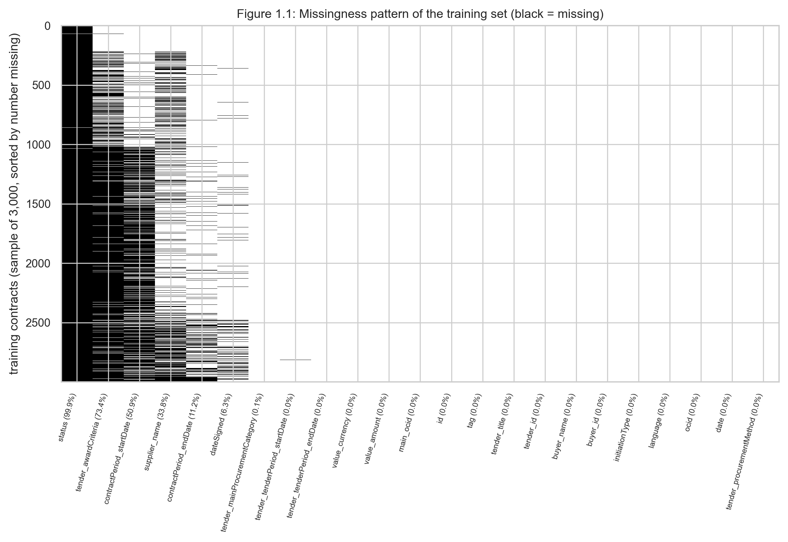
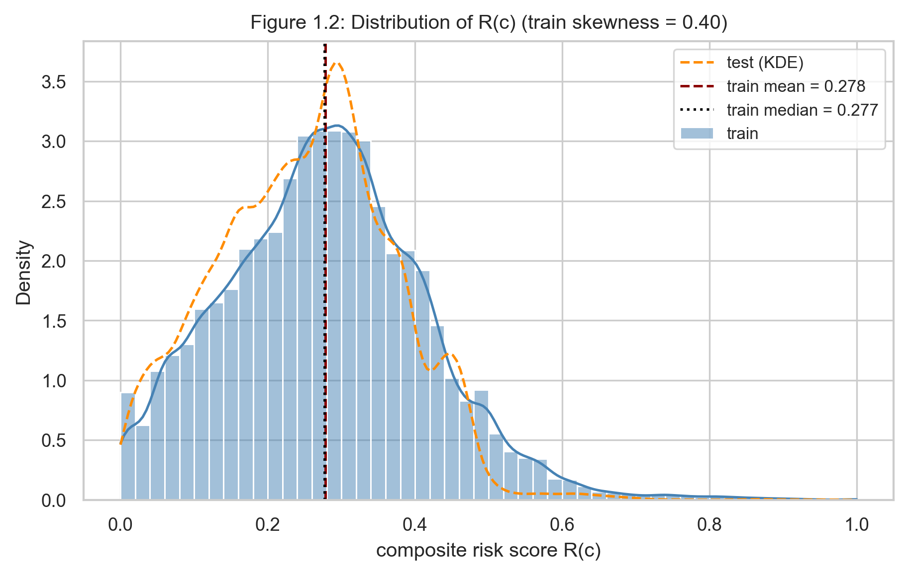
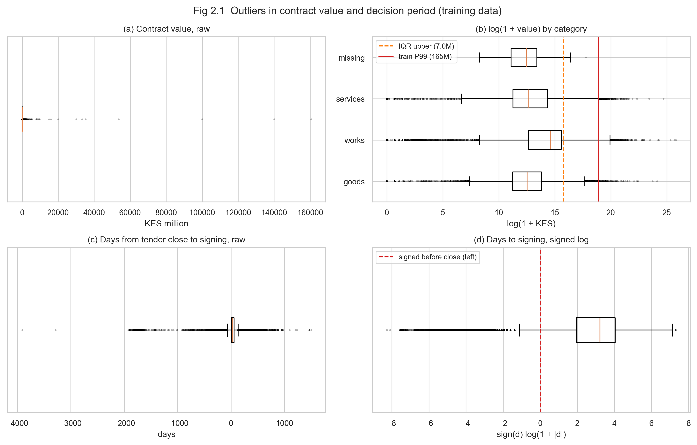
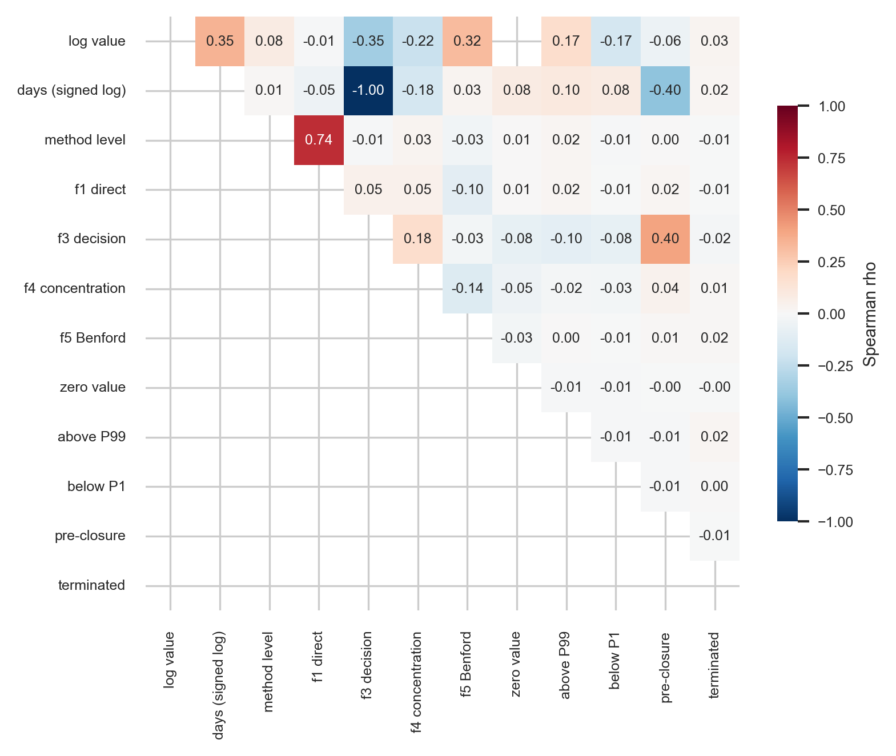
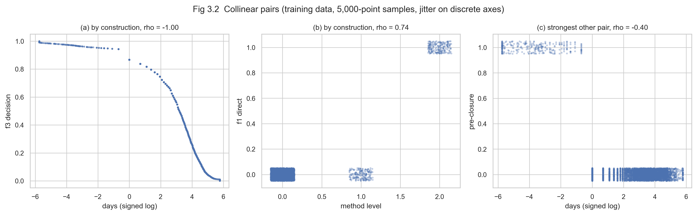
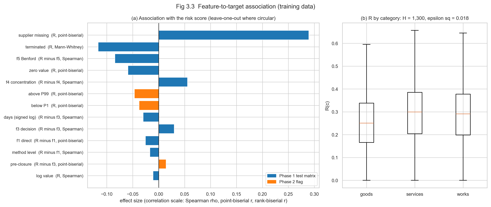
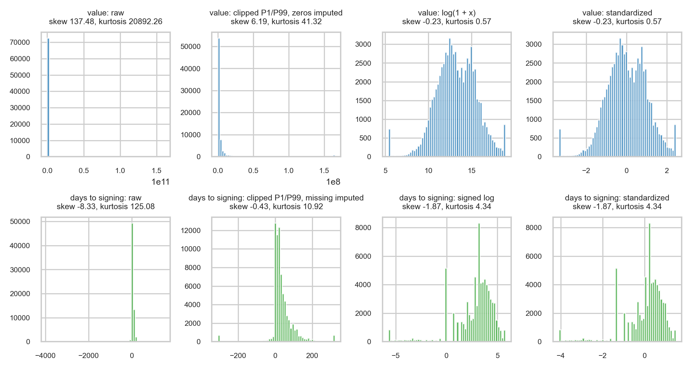
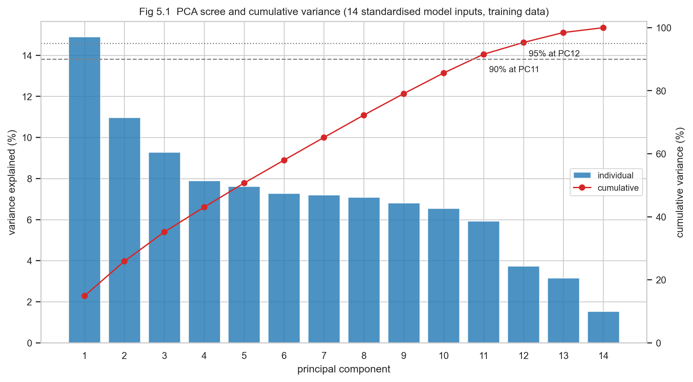

# An Explainable Risk-Triage System for Public Procurement Oversight in Kenya

An explainable AI system that ranks Kenyan government contracts by integrity risk and presents them to auditors as a prioritized review queue. Addresses UN SDG 16: Peace, Justice and Strong Institutions.

**Status.** Both project phases are complete. **Phase 1** audited the raw data and designed the preprocessing strategy. **Phase 2** implemented that strategy as a tested, leakage-controlled scikit-learn pipeline and audited every Phase 1 decision against the real data. This README contains both phases in full; `phase1_strategy/Phase1_Strategy_Report.pdf` and `phase2_implementation/Phase2_Implementation_Report.pdf` present the same work in report form.

## Contents

1. [Problem Statement](#problem-statement)
2. [Task Type and Target](#task-type-and-target)
3. **Phase 1: Data Audit and Preprocessing Strategy**
   - [Data Overview](#phase-1-data-overview)
   - [Preprocessing Strategy](#phase-1-preprocessing-strategy)
   - [Decision Log](#phase-1-decision-log)
   - [Strategy Tracking](#phase-1-strategy-tracking)
4. **Phase 2: Implementation and Validation**
   - [Overview](#phase-2-overview)
   - [Data and Split](#phase-2-data-and-split)
   - [Missingness](#phase-2-missingness)
   - [Indicators and the Risk Score](#phase-2-indicators-and-the-risk-score)
   - [Supplier Entity Resolution](#phase-2-supplier-entity-resolution)
   - [Single Bidding (f6)](#phase-2-single-bidding-f6)
   - [Outliers](#phase-2-outliers)
   - [Multicollinearity](#phase-2-multicollinearity)
   - [Feature-to-Target Association](#phase-2-feature-to-target-association)
   - [Transformations and the Pipeline](#phase-2-transformations-and-the-pipeline)
   - [Dimensionality](#phase-2-dimensionality)
   - [Model Tuning and Validation](#phase-2-model-tuning-and-validation)
   - [Decision Log](#phase-2-decision-log)
   - [Limitations and Next Steps](#phase-2-limitations-and-next-steps)
5. [Repository Structure](#repository-structure)
6. [How to Reproduce](#how-to-reproduce)
7. [References](#references)

---

## Problem Statement

Kenya publishes over 260,000 public procurement records through the Public Procurement Regulatory Authority (PPRA), covering national government and all 47 counties. Oversight bodies review contracts by hand and can inspect only a fraction of them. The constraint is no longer access to records: it is the lack of a way to decide which records deserve attention first.

This project builds a risk-triage system that ranks contracts by integrity risk and returns them to an auditor as a prioritized review queue, with the reasons for each flag. The intended users are procurement analysts and investigators at oversight bodies such as the Ethics and Anti-Corruption Commission (EACC) and the PPRA, and civil-society procurement monitors.

The system estimates **review priority, not wrongdoing**. Red-flag indicators are proxies for risk and fire on legitimate contracts as well as irregular ones, so the output informs human judgement rather than constituting a finding.

---

## Task Type and Target

**Unsupervised risk ranking.** No dataset labels a Kenyan contract as corrupt. Framing this as supervised classification or regression would require inventing labels, making any reported accuracy meaningless.

The target $`Y`$ is a composite risk score built from red-flag indicators, following the Corruption Risk Index (CRI) methodology [3, 4]. Each indicator $`f_k`$ lies in $`[0, 1]`$, and the score averages the indicators available for each contract:

```math
R(c) = \frac{\sum_{k \in A(c)} w_k \, f_k(c)}{\sum_{k \in A(c)} w_k}
```

where $`A(c)`$ is the set of indicators computable for contract $`c`$. Equal weights are the default.

Two components produce the ranking. A **rule-based composite index** $`R(c)`$ supplies transparent, literature-grounded signals and is the primary output. An **Isolation Forest** [7] complements it by detecting contracts that are unusual in the combination of their features, even where no single flag is extreme.

- **Sample size ($`N`$):** 277,325 merged rows; the 109,163 awarded contracts form the scoring unit
- **Feature count ($`P`$):** 23 raw columns in the merged working table
- **Target ($`Y`$):** $`R(c) \in [0, 1]`$, the average of the available red-flag indicators

---

## Phase 1: Data Overview

Everything in this section describes the **raw data, before any preprocessing**. The figures and numbers are reproduced by `phase1_strategy/data_overview.py`.

### Source

- **Publisher:** Kenya PPRA, via the Open Contracting Partnership Data Registry, publication 147 [1]: <https://data.open-contracting.org/en/publication/147>
- **Standard:** Open Contracting Data Standard (OCDS) 1.1 [2]
- **Format:** one archive, `kenya_ppra_full.csv.tar.gz` (about 55 MB), containing five linked CSV files
- **Coverage:** July 2018 to August 2026
- **Licence:** open government data under Executive Order No. 2 of 2018; no explicit licence is declared

### The Five Files

The release follows the life of a public purchase: a buyer announces a **tender**, picks a winner (the **award**), names the winning **supplier**, signs a **contract**, and every organization involved is listed as a **party**.

| File | Rows | Columns | One row is | What it tells us |
|---|---:|---:|---|---|
| `main.csv` | 259,709 | 15 | a tender | who is buying, what, how the supplier is chosen, and the bidding dates |
| `awards.csv` | 109,163 | 9 | an award | the value of each award and the planned contract period |
| `awards_suppliers.csv` | 79,870 | 5 | a named winner | which supplier won each award |
| `contracts.csv` | 109,163 | 12 | a signed contract | when the contract was signed and its status |
| `parties.csv` | 813,078 | 16 | an organization in a process | every buyer and supplier, with registration and contact details |

**How they link.** Every file links back to `main.csv` through `main_ocid`, which matches `ocid` in `main.csv`. Awards link to suppliers through `awards_suppliers.awards_id` and to contracts through `contracts.awardID`, both matching `awards.id`.

**What the row counts already show.** 259,709 tenders produced only 109,163 awards: 168,162 tenders (60.6%) have no recorded award. And 109,163 awards have only 79,870 named winners: 26.8% of awards do not record who won.

### Features in Each File

Missing percentages are measured on each file before merging.

#### `main.csv`: tenders (259,709 rows)

| Column | Type | Description | Missing % |
|---|---|---|---:|
| `id` | Nominal | Record ID of the compiled release | 0.00 |
| `tag` | Nominal | Release stage; always "compiled" | 0.00 |
| `date` | Datetime | When the record was published, not when the tender happened | 0.00 |
| `ocid` | Nominal | Open Contracting ID: one per procurement process; the main join key | 0.00 |
| `language` | Nominal | Always "en" | 0.00 |
| `initiationType` | Nominal | Always "tender" | 0.00 |
| `buyer_id` | Discrete | ID of the buying government entity (1,211 distinct buyers) | 0.00 |
| `buyer_name` | Nominal | Name of the buying entity | 0.00 |
| `tender_id` | Nominal | The buyer's own reference number | 0.00 |
| `tender_title` | Text | What is being purchased, in free text | 0.00 |
| `tender_mainProcurementCategory` | Nominal | Goods, works or services | 0.26 |
| `tender_procurementMethod` | Ordinal | How the supplier was chosen: open, selective, direct, and three rare methods | 0.00 |
| `tender_tenderPeriod_startDate` | Datetime | When bidding opened | 0.09 |
| `tender_tenderPeriod_endDate` | Datetime | The bidding deadline | 0.09 |
| `tender_awardCriteria` | Nominal | The rule used to pick the winner, such as lowest price | 79.30 |

#### `awards.csv`: awards (109,163 rows)

| Column | Type | Description | Missing % |
|---|---|---|---:|
| `id` | Nominal | Award ID; links to suppliers and contracts | 0.00 |
| `title` | Text | What was awarded | 0.00 |
| `description` | Text | Longer description of the award | 95.25 |
| `value_amount` | Continuous | Award value | 0.00 |
| `value_currency` | Nominal | Always "KES" (Kenyan Shilling) | 0.00 |
| `contractPeriod_startDate` | Datetime | Planned contract start | 34.60 |
| `contractPeriod_endDate` | Datetime | Planned contract end | 10.46 |
| `main_ocid` | Nominal | Link to the tender in `main.csv` | 0.00 |
| `main_id` | Nominal | Link to the release record in `main.csv` | 0.00 |

#### `awards_suppliers.csv`: winning suppliers (79,870 rows)

| Column | Type | Description | Missing % |
|---|---|---|---:|
| `id` | Nominal | Supplier record ID; not a stable firm ID (23.76% of names appear under more than one ID) | 0.00 |
| `name` | Text | Supplier name as written, with inconsistent spelling and case | 0.00 |
| `main_ocid` | Nominal | Link to the tender | 0.00 |
| `main_id` | Nominal | Link to the release record | 0.00 |
| `awards_id` | Nominal | Link to the award in `awards.csv` | 0.00 |

#### `contracts.csv`: signed contracts (109,163 rows)

| Column | Type | Description | Missing % |
|---|---|---|---:|
| `id` | Nominal | Contract reference, including the buyer's contract number | 0.00 |
| `title` | Text | What the contract is for | 0.00 |
| `description` | Text | Longer description | 95.25 |
| `dateSigned` | Datetime | When the contract was signed | 13.64 |
| `awardID` | Nominal | Link to the award in `awards.csv` | 0.00 |
| `value_amount` | Continuous | Contract value; matches the award value | 0.00 |
| `value_currency` | Nominal | Always "KES" | 0.00 |
| `period_startDate` | Datetime | Contract start | 3.12 |
| `period_endDate` | Datetime | Contract end | 10.46 |
| `main_ocid` | Nominal | Link to the tender | 0.00 |
| `main_id` | Nominal | Link to the release record | 0.00 |
| `status` | Nominal | Only ever filled as "terminated" (105 contracts) | 99.90 |

#### `parties.csv`: organizations (813,078 rows)

| Column | Type | Description | Missing % |
|---|---|---|---:|
| `id` | Nominal | Organization ID | 0.00 |
| `name` | Text | Organization name | 0.02 |
| `roles` | Nominal | "buyer" or "supplier" | 0.00 |
| `main_ocid` | Nominal | Link to the tender | 0.00 |
| `main_id` | Nominal | Link to the release record | 0.00 |
| `address_region`, `address_locality`, `address_countryName` | Nominal | Where the organization is based | 32.10 |
| `address_postalCode` | Nominal | Postal code | 85.15 |
| `address_streetAddress` | Text | Street address | 84.63 |
| `identifier_id` | Nominal | Registration number; present for 100% of suppliers | 32.10 |
| `identifier_scheme` | Nominal | Which registry issued the number | 32.10 |
| `identifier_legalName` | Text | Official registered name | 32.12 |
| `contactPoint_name` | Text | Contact person | 82.84 |
| `contactPoint_email` | Text | Contact email | 85.69 |
| `contactPoint_telephone` | Text | Contact phone number | 87.05 |

### The Merged Working Table

For analysis, `main`, `awards`, `awards_suppliers` and `contracts` are joined into one table of **277,325 rows by 23 columns**: one row per award, plus one row for each tender with no award. It is larger than `main.csv` because 91,547 tenders carry the 109,163 awards between them.

| Merged-table measure | Value |
|---|---|
| Missing cells | 27.73% |
| Rows complete across all 23 columns | 1 |
| Rows complete, excluding `status` and `tender_awardCriteria` | 38,538 (13.90%) |
| Tenders with no award | 168,162 (60.6%) |

Missingness of the award-stage columns at merged-table level, and among the 109,163 awarded rows:

| Column | Missing | % merged | % of awarded | Mechanism and evidence |
|---|---:|---:|---:|---|
| `status` | 277,220 | 99.96 | 99.90 | MNAR: only terminations are ever recorded |
| `tender_awardCriteria` | 219,751 | 79.24 | n/a | MNAR: selection criteria left undocumented |
| `contractPeriod_startDate` | 205,933 | 74.26 | 34.60 | Structural + MAR |
| `supplier_name` | 197,455 | 71.20 | 26.83 | Structural + MNAR: winner not recorded |
| `dateSigned` | 183,072 | 66.01 | 13.66 | Structural + MAR |
| `contractPeriod_endDate` | 179,576 | 64.75 | 10.46 | Structural + MAR |
| `value_amount`, `value_currency`, `main_ocid` | 168,162 | 60.64 | 0.00 | Structural: tender has no award |
| `tender_mainProcurementCategory` | 722 | 0.26 | n/a | MAR |
| tender-period start and end dates | 248 | 0.09 | n/a | Both missing together |
| remaining 12 columns | 0 | 0.00 | 0.00 | Complete |

"Structural" means the field does not exist because the tender never reached the award stage. The mechanisms are tested in the next section.

### Statistical Diagnostics

**Category frequencies (tender level).**

| Procurement method | Tenders | % |
|---|---:|---:|
| open | 233,594 | 89.94 |
| selective | 17,268 | 6.65 |
| direct | 8,744 | 3.37 |
| SpeciallyPermitted | 56 | 0.02 |
| AlternativeSelection | 41 | 0.02 |
| community participation | 6 | 0.00 |

Procurement category: works 115,930 (44.6%), goods 85,268 (32.8%), services 57,833 (22.3%), missing 678 (0.3%).

**Award values (all 109,163 awards).**

| Statistic | Value |
|---|---|
| Mean / median | 15,409,356 / 498,150 KES |
| Maximum | 160.6 billion KES |
| Quartiles Q1 / Q3 | 111,537 / 2,599,744 KES |
| Skewness | 161.0 (extremely right-skewed) |
| Skewness of log(1 + value) | −1.38, or −0.51 once the zeros are excluded |
| Zero-value awards | 1,129 (1.03%) |
| IQR upper bound (Q3 + 1.5 × IQR) | 6,332,053 KES; 12.0% of awards lie above it |
| 99th percentile | 135,000,000 KES |

**Dates.**

| Measure | Value |
|---|---|
| Advertisement period (bidding end − start) | 44.0% of tenders negative (42.2% counted per merged row, as in the Phase 1 report); median 0 days among the rest |
| Decision period (signing − bidding end) | n = 94,140; median 22 days; 7.6% signed before bidding closed; skewness −2.69 |

**Missingness mechanism tests.** A chi-square test of independence between each column's missingness and the procurement competition level (open / restricted / non-competitive). A small p-value rejects Missing Completely at Random (MCAR). Cramér's V measures how strong the link is; with this many rows it matters more than p.

| Column | Missing % | χ² | p | Cramér's V | Missing % open / restricted / non-competitive | MCAR |
|---|---:|---:|---:|---:|---|---|
| `dateSigned` | 13.66 | 137.5 | 1.4e-30 | 0.035 | 13.93 / 12.96 / 7.35 | rejected |
| `contractPeriod_startDate` | 34.60 | 118.1 | 2.3e-26 | 0.033 | 34.60 / 28.95 / 40.57 | rejected |
| `contractPeriod_endDate` | 10.46 | 114.5 | 1.4e-25 | 0.032 | 10.42 / 7.39 / 14.68 | rejected |
| `supplier_name` | 26.83 | 21.7 | 1.9e-05 | 0.014 | 26.66 / 28.65 / 29.44 | rejected |
| `tender_mainProcurementCategory` | 0.26 | 1420.3 | 3.8e-309 | 0.074 | 0.17 / 1.67 / 0.01 | rejected |
| `tender_awardCriteria` | 79.30 | 493.7 | 6.2e-108 | 0.044 | 79.21 / 84.01 / 72.35 | rejected |

Award columns are tested on awarded rows only, tender columns on unique tenders. Every column rejects MCAR, but every link is weak (V below 0.1): the gaps are not random, yet procurement method explains only a small part of them. Missing Not at Random (MNAR) cannot be tested from data alone.

**Suppliers.** 23.76% of normalized supplier names appear under more than one supplier ID, while no ID carries more than one name, so the ID marks a record, not a firm. In 79.3% of processes, `parties.csv` lists more suppliers than there are winners (median 3), suggesting losing bidders are recorded too.

### Figures

**Missingness pattern.** The black block at the top is the 60.6% of tenders with no award: their award columns do not exist, rather than being missing.


**Missing rate by competition level.** The visual version of the MAR tests: rates differ by level, but only slightly.


**Tenders per year.** How the records spread over time, and the share with a recorded award.


**Method and category frequencies.** Open tenders dominate; three methods have fewer than 60 tenders each.


**Award values.** On a log scale the values become readable; the box plot shows the IQR bound and the long upper tail.


**Date diagnostics.** Many advertisement periods are negative, which is a recording problem; contracts signed before bidding closed are a possible red flag.


---

## Phase 1: Preprocessing Strategy

Every decision below is justified by a finding in the [Data Overview](#phase-1-data-overview).

> This section records the strategy as designed in Phase 1. Several decisions were changed by Phase 2 evidence; see the [Phase 2 Decision Log](#phase-2-decision-log) for what changed and why.

### Scoring Unit

The 168,162 unawarded tenders have no value, supplier or contract to review. They are audited but not scored. The scoring unit is the **awarded contract** (109,163 rows), because that is the object an auditor reviews. This removes the structural share of every award-stage column's missingness.

### Missingness Treatment

**MNAR columns: binary flags, never imputed.** These are missing because of what the value would have been. An undocumented selection rule or an unnamed winner is itself a transparency failure, so imputing would erase the signal. Each becomes a flag:

- `award_criteria_missing` = 1 if `tender_awardCriteria` is blank, else 0
- `supplier_missing` = 1 if an award has no named supplier (26.83% of awards), else 0
- `is_terminated` = 1 if `status` equals "terminated", else 0

MNAR cannot be proven from data alone; this diagnosis rests on domain reasoning.

**MAR columns: imputed within procurement-method groups.** The chi-square tests reject MCAR.

- `dateSigned` (13.66% of awards; open 13.9%, restricted 13.0%, non-competitive 7.4%). Where it is missing, the decision-period indicator $`f_3`$ is dropped from $`A(c)`$ rather than imputed. For the Isolation Forest input `days_to_signing`, missing values are imputed with the **median within each procurement method**, recorded in a flag `signing_date_missing`. The median is used rather than the mean because the distribution is strongly skewed (−2.69).
- `tender_mainProcurementCategory` (722 rows, 0.26%) was expected to be MCAR, but it is missing ten times more often for restricted tenders (1.67%) than for open ones (0.17%). It is imputed with the **mode within each procurement method**. The gaps are spread over 256 buyers, with no buyer above 3.6%, so they are not one buyer's reporting habit.
- `contractPeriod_startDate` and `contractPeriod_endDate` are also MAR, but they feed no indicator, so they are kept for display and **excluded from model inputs**. Imputing a field the model never uses adds no information.

**Tender-period dates.** The 248 records missing both dates cannot be placed in time, so they are excluded at the split instead of imputed. KNN and multiple imputation were rejected for these small gaps: they add computational cost for negligible gain.

### Outlier Treatment

`value_amount` is heavily right-skewed (skewness 161.0), so the **IQR rule** is used for detection. The Z-score rule was rejected because it assumes a Gaussian distribution.

```math
\text{Lower} = Q_1 - 1.5 \times IQR, \qquad \text{Upper} = Q_3 + 1.5 \times IQR
```

With $`Q_1 = 111{,}537`$ and $`Q_3 = 2{,}599{,}744`$ KES, the upper bound is 6,332,053 KES and the lower bound is negative. 12.0% of awards exceed the upper bound. Capping there would truncate one award in eight, mostly legitimate large works contracts.

**Treatment: Winsorization at the 99th percentile**, not row deletion and not IQR capping. The threshold is learned on the training set only (135,000,000 KES on the full data). A row with an extreme value still carries valid signal in every other column, so deleting it loses information. Because extreme values matter in integrity analysis, a flag `above_p99` records that a value was capped, and the raw value stays visible to auditors.

**Zero-value awards** (1,129, 1.03%) are not plausible for a signed award. Each is flagged in `zero_value_award` and excluded from the value-based indicators $`f_4`$ and $`f_5`$; a zero has no first digit for Benford's law. For the Isolation Forest value input, zeros are imputed with the median within procurement category, with the flag retained.

### Entity Resolution

Supplier IDs are not stable firm IDs: 23.76% of normalized names appear under more than one ID. Resolution has three stages:

1. **Exact:** normalize names (case, whitespace, punctuation, legal suffixes such as Ltd/Limited) and merge exact matches. This alone collapses the multi-ID names.
2. **Fuzzy:** token sort ratio of at least 90 within blocks sharing a first token, to catch spelling variants.
3. **Confirm:** `identifier_id` in `parties.csv`, present for 100% of supplier parties, confirms or vetoes each candidate merge.

The error rate is estimated on 200 hand-labelled supplier-name pairs (precision and recall). High-risk suppliers are then checked against the [World Bank Debarred Firms list](https://www.worldbank.org/en/projects-operations/procurement/debarred-firms), the [Kenya Gazette](https://new.kenyalaw.org/gazettes/) company register, and the [OpenSanctions](https://www.opensanctions.org/datasets/default/) database of politically exposed persons.

### Feature Engineering

Five indicators enter $`R(c)`$, plus one candidate pending validation [4, 5, 6].

**$`f_1`$, direct award.** 1 if the procurement method is "direct" or "SpeciallyPermitted", else 0. These methods bypass competition; 8,800 tenders (3.4%) use them.

**$`f_2`$, award criteria missing.** 1 if `tender_awardCriteria` is blank, else 0.

**$`f_3`$, decision period.** The days between the bidding deadline and contract signing. A very short decision period suggests the evaluation was decided in advance [3]:

```math
d(c) = t_{\text{signed}}(c) - t_{\text{close}}(c), \qquad f_3(c) = 1 - \hat{F}_{\text{train}}\big(d(c)\big)
```

where $`\hat{F}_{\text{train}}`$ is the empirical distribution function of $`d`$ on the training set, so shorter periods score higher. Contracts signed before bidding closed (7.6%) receive the highest scores: they are either irregular or recording errors, and both warrant review. $`f_3`$ **replaces the advertisement period** originally planned, which is unusable: 44.0% of tenders have a start date after the end date, and the rest have a median of 0 days. Imputing it would manufacture a signal.

**$`f_4`$, supplier concentration.** The share of buyer $`b`$'s earlier awarded value that went to supplier $`s`$, over an expanding window of awards dated before contract $`c`$, after entity resolution and excluding zero values:

```math
f_4(c) = \frac{\sum_{c' \in C^{\lt t}_{b,s}} v(c')}{\sum_{c' \in C^{\lt t}_{b}} v(c')}
```

where $`C^{\lt t}_{b}`$ is buyer $`b`$'s awards before the date $`t`$ of contract $`c`$, and $`C^{\lt t}_{b,s}`$ the subset won by $`s`$. Values near 1 indicate dependence on one supplier.

**$`f_5`$, Benford deviation.** Conformity of buyer $`b`$'s earlier non-zero award values to Benford's law, measured by the mean absolute deviation (MAD) of first-digit proportions:

```math
\text{MAD}_b = \frac{1}{9}\sum_{d=1}^{9}\left|\hat{p}_{b,d} - E_d\right|, \qquad E_d = \log_{10}\!\left(1 + \tfrac{1}{d}\right)
```

and $`f_5(c) = \hat{F}_{\text{train}}(\text{MAD}_b)`$. MAD is chosen over chi-squared because chi-squared grows with sample size, so large buyers would score higher for the same proportional deviation. $`f_5`$ requires at least 100 earlier awards.

**$`f_6`$ (candidate), single supplier party.** The release has no tenderer count, so single bidding, the most validated CRI indicator [4], cannot be read directly. But 79.3% of processes list more supplier parties than winners, consistent with bidders being recorded as parties. $`f_6 = 1`$ if a process lists exactly one supplier party. It enters $`R(c)`$ only if a manual check of 50 processes against tender notices on the PPRA portal confirms that the extra parties are bidders.

**Indicator coverage map.** Which integrity indicators the release can and cannot support:

| Indicator | Source fields | Coverage (awarded contracts) | Status |
|---|---|---|---|
| $`f_1`$ direct award | procurement method | 100% | Used |
| $`f_2`$ criteria missing | award criteria | 100% | Used |
| $`f_3`$ decision period | `dateSigned`, tender end date | 86.2% | Used |
| $`f_4`$ supplier concentration | value, resolved supplier | all but a buyer's first award | Used |
| $`f_5`$ Benford MAD | value | buyers with at least 100 earlier awards | Used |
| $`f_6`$ single supplier party | `parties.csv` | 79.3% list extra parties | Pending validation |
| Advertisement period | tender start and end dates | 44.0% negative | Rejected |
| Single bidding (tenderer count) | `tender.tenderers` | absent from the release | Not computable |

### Encoding

- **Procurement method: ordinal, three levels.** open = 0 (233,594); restricted = 1 (selective 17,268, AlternativeSelection 41, community participation 6); non-competitive = 2 (direct 8,744, SpeciallyPermitted 56). The rare methods are too small for levels of their own, and there is no defensible order between direct and specially permitted awards. One-hot encoding was rejected because it would discard the ordering of competition levels.
- **Procurement category: one-hot.** Goods, works and services have no natural order, so ordinal encoding was rejected. One level is dropped to avoid perfect collinearity in the VIF screen and PCA.
- **Binary flags:** `award_criteria_missing`, `supplier_missing`, `is_terminated`, `zero_value_award`, `above_p99`, `signing_date_missing`.
- **Dropped:** `language`, `initiationType`, `tag` and `value_currency` (constant), identifier columns used only for joining, and the contract-period dates (used by no indicator).

### Scaling and Transformation

**`value_amount`: Winsorize, log, then standardize.**

```math
x_v(c) = \log\big(1 + \min(v(c),\, q^{\text{train}}_{0.99})\big)
```

The Isolation Forest chooses each split value uniformly between a feature's minimum and maximum. On the raw scale, with a median of 498,150 KES and a maximum of 160.6 billion KES, almost every split would fall in the empty upper range, so the log transform genuinely changes model behaviour. $`\log(1 + x)`$ is used rather than $`\log(x)`$ because $`\log(0)`$ is undefined. StandardScaler ($`\mu = 0`$, $`\sigma = 1`$) does not affect the Isolation Forest, which is invariant to per-feature scaling, but it is required for PCA and the VIF screen, where unequal variances would let one feature dominate. MinMaxScaler was rejected because it is sensitive to the remaining extreme values.

**`days_to_signing`: signed log, then standardize.** 7.6% of values are negative, so $`\log(1 + x)`$ cannot be applied. $`\text{sign}(d)\log(1 + |d|)`$ compresses both tails.

**Indicators $`f_1`$ to $`f_6`$** lie in $`[0, 1]`$ by construction, either binary or empirical-distribution scores, so they need no further scaling for $`R(c)`$. They are standardized only for PCA.

### Statistical Test Matrix

Because $`R(c)`$ is built from the indicators, correlating an indicator with $`R(c)`$ would be circular: the association is guaranteed by construction. Each indicator $`f_k`$ is therefore tested against the **leave-one-out score** $`R_{-k}(c)`$, which excludes $`f_k`$. Inputs that are not components are tested against $`R(c)`$. The procurement method and `days_to_signing` are tested against $`R_{-1}`$ and $`R_{-3}`$, since $`f_1`$ and $`f_3`$ are built from them.

| Feature | Type | Target | Chosen / Rejected / Reason |
|---|---|---|---|
| $`f_1`$ direct award | Binary | $`R_{-1}`$ | **Chosen:** point-biserial $`r`$. **Rejected:** chi-square, which needs a categorical target. |
| $`f_2`$ criteria missing | Binary | $`R_{-2}`$ | Same as $`f_1`$. |
| $`f_3`$ decision-period score | Continuous, [0, 1] | $`R_{-3}`$ | **Chosen:** Spearman $`\rho`$. **Rejected:** Pearson $`r`$; $`R`$ mixes binary and rank-based components, so it is not Gaussian, and $`d`$ has skewness −2.69. |
| $`f_4`$ supplier concentration | Continuous, [0, 1] | $`R_{-4}`$ | **Chosen:** Spearman $`\rho`$. **Rejected:** Pearson $`r`$; shares typically pile up at 0 and 1. |
| $`f_5`$ Benford deviation | Continuous, [0, 1] | $`R_{-5}`$ | Same as $`f_4`$. |
| $`f_6`$ single supplier party | Binary | $`R_{-6}`$ | Same as $`f_1`$, if validated. |
| `value_amount` (log) | Continuous | $`R`$ | **Chosen:** Spearman $`\rho`$. **Rejected:** Pearson $`r`$; skewness −0.51 excluding zeros, −1.38 with them. |
| `days_to_signing` | Continuous | $`R_{-3}`$ | **Chosen:** Spearman $`\rho`$. **Rejected:** Pearson $`r`$; skewness −2.69. |
| procurement method | Ordinal, 3 levels | $`R_{-1}`$ | **Chosen:** Spearman $`\rho`$. **Rejected:** Pearson $`r`$; codes 0 to 2 are ranks with unequal gaps. |
| procurement category | Nominal, 3 levels | $`R`$ | **Chosen:** Kruskal-Wallis $`H`$ with $`\varepsilon^2`$ effect size, plus mutual information. **Rejected:** ANOVA $`F`$, which assumes normal within-group distributions that a bounded, non-Gaussian $`R`$ violates; Pearson and Spearman, which need an ordering. |
| `supplier_missing`, `zero_value_award` | Binary | $`R`$ | **Chosen:** point-biserial $`r`$, as for $`f_1`$. |
| `is_terminated` | Binary, 0.10% positive | $`R`$ | **Chosen:** Mann-Whitney $`U`$ with rank-biserial effect size. **Rejected:** point-biserial $`r`$, which is unstable with only 105 positives. |

### Multicollinearity Protocol

- **Screen:** pairwise Spearman $`|\rho| \geq 0.85`$ on continuous inputs (Spearman because the inputs are skewed and bounded), with the Variance Inflation Factor (VIF) above 10 on standardized inputs as a secondary check.
- **Decision rule:** keep the feature with higher coverage; on a tie, keep the literature-validated indicator. Association with $`R(c)`$ is never used as the tie-break, because that would reintroduce circularity.
- **Pairs collinear by construction, resolved in advance:** $`f_3`$ is a monotone transform of `days_to_signing`, and $`f_1`$ is the top level of the method encoding. The Isolation Forest receives the richer variable of each pair (`days_to_signing` and the method level), while $`R(c)`$ uses the indicators.

### Split and Leakage Prevention

**Temporal split by tender end date.** A random split would let a model trained on 2025 contracts score 2024 contracts, which is look-ahead bias. Upload dates were rejected because they record publication, not the procurement: tenders closing in 2021 carry 2025 upload timestamps.

| Set | Tender end date | Awarded contracts | Share |
|---|---|---:|---:|
| Train | 2018 to 2023 | 72,585 | 66.6% |
| Test | 2024 to 2026 | 36,399 | 33.4% |
| Excluded | missing or outside the window | 179 | 0.16% |

This mirrors deployment: a model trained on history scores contracts as they arrive.

**Hyperparameter selection.** `TimeSeriesSplit` with 5 folds inside the training period, each validation fold strictly after its training fold. With no labels, the criterion is **rank stability**: the Spearman correlation between the score rankings of the same validation fold under different random seeds. The number of trees and the subsample size are chosen to maximize it. The contamination parameter is not tuned, because the output is a ranking, not a binary label.

**Buyer-history leakage.** Supplier concentration and Benford deviation depend on a buyer's history. Both use an **expanding window**: a contract's buyer-level features use only that buyer's awards dated before it, in training, test and deployment alike. GroupKFold was rejected: separating a buyer's history from its future is exactly what these features need, and the leakage risk here is temporal ordering, not shared identity.

**Transformer fit architecture.** Every learned step is fit on `X_train` only, inside `sklearn.pipeline.Pipeline` and `ColumnTransformer`:

1. **Fit on `X_train` only:** impute category (mode within method) and `days_to_signing` (median within method), with flags; Winsorize value at the training 99th percentile, then $`\log(1 + x)`$; signed log for `days_to_signing`; fit the ordinal encoder (3 levels), one-hot encoder (drop first) and StandardScaler; fit the empirical distribution functions for $`f_3`$ and $`f_5`$; fit the Isolation Forest.
2. **For every contract, in date order:** compute $`f_4`$ and $`f_5`$ from the buyer's awards dated before it.
3. **Transform `X_test` without refitting:** apply all fitted transformers, then score $`R(c)`$ and the Isolation Forest's `decision_function`.

$`R(c)`$ is computed only from the contract's own record and from history dated before it, so no future information enters any feature.

---

## Phase 1: Decision Log

The Phase 1 plan. The [Phase 2 Decision Log](#phase-2-decision-log) compares each entry with what was implemented.

| Decision | Justification | Method |
|---|---|---|
| Unawarded tenders | 60.6% have no award stage | Audited, not scored |
| MNAR missingness | Missingness is itself a risk signal | Binary flag |
| `dateSigned` (MAR) | Rate varies by method (7.4% to 13.9%) | $`f_3`$ unavailable; median within method + flag |
| Category (MAR) | Restricted 1.67% vs open 0.17% | Mode within method |
| Contract-period dates | Feed no indicator | Excluded from model inputs |
| Missing tender dates | Cannot be placed in time | Excluded at split |
| Zero-value awards | 1,129 implausible values | Flag; excluded from $`f_4`$, $`f_5`$ |
| Extreme values | 12.0% exceed the IQR bound; skewness 161.0 | Winsorize at training P99 + flag |
| `value_amount` transform | Uniform splits on a raw scale fail | $`\log(1 + x)`$, then StandardScaler |
| `days_to_signing` transform | 7.6% negative, skewness −2.69 | Signed log, then StandardScaler |
| Advertisement period | 44.0% negative, median 0 days | Rejected; replaced by decision period |
| Benford measure | Chi-squared grows with sample size | MAD, at least 100 earlier awards |
| Procurement method | Ordered competition levels | Ordinal encoding 0 to 2 |
| Procurement category | No natural order | One-hot encoding |
| Constant columns | Zero variance | Drop |
| Feature-target tests | Indicators are components of $`R`$ | Leave-one-out score $`R_{-k}`$ |
| Train/test split | Prevent look-ahead bias | Tender end date, 66.6 / 33.4 |
| Hyperparameter search | No labels available | TimeSeriesSplit, rank stability |
| Buyer-history leakage | Features need buyer history | Expanding window |
| Transformer fit | Must not see test data | Fit on `X_train` only via Pipeline |

---

## Phase 1: Strategy Tracking

How each finding in the raw data shaped the strategy.

| Finding in the raw data | Strategy decision | Where |
|---|---|---|
| 60.6% of tenders have no award | Score awarded contracts only | [Scoring Unit](#scoring-unit) |
| `date` records publication, not the tender | Split by tender end date | [Split](#split-and-leakage-prevention) |
| `tender_awardCriteria` 79.3% missing, MCAR rejected | Binary flag, never imputed | [Missingness](#missingness-treatment) |
| 26.8% of awards name no winner | Flag `supplier_missing` | [Missingness](#missingness-treatment) |
| `status` only ever says "terminated" | Flag `is_terminated` | [Missingness](#missingness-treatment) |
| `dateSigned` missingness depends on method (V = 0.035) | Median within procurement method | [Missingness](#missingness-treatment) |
| Category missing ten times more for restricted tenders | Mode within procurement method | [Missingness](#missingness-treatment) |
| Contract dates MAR but used by no indicator | Excluded from model inputs | [Missingness](#missingness-treatment) |
| Award skewness 161.0; IQR bound flags 12.0% | IQR for detection; cap at P99 | [Outliers](#outlier-treatment) |
| 1,129 zero-value awards | Flag; excluded from value indicators | [Outliers](#outlier-treatment) |
| Supplier IDs are not stable firm IDs | Three-stage entity resolution | [Entity Resolution](#entity-resolution) |
| Advertisement period 44.0% negative | Rejected; replaced by decision period | [Feature Engineering](#feature-engineering) |
| Decision period valid for 94,140 awards | Indicator $`f_3`$ | [Feature Engineering](#feature-engineering) |
| `parties.csv` lists extra suppliers in 79.3% of processes | Candidate indicator $`f_6`$ | [Feature Engineering](#feature-engineering) |
| Three methods have under 60 tenders each | Three competition levels | [Encoding](#encoding) |
| Log of value still skewed (−1.38) | Spearman instead of Pearson | [Statistical Test Matrix](#statistical-test-matrix) |

---

---

## Phase 2: Overview

Phase 2 implements the Phase 1 design on the real data and audits every Phase 1 decision against measured evidence. For each step, the sections below state what was planned, what the data showed and what was decided, together with the statistic or figure behind the decision. The [Phase 2 Decision Log](#phase-2-decision-log) collects every decision in one table.

Three validation exercises go beyond the original plan: supplier entity resolution is validated on hand-labeled pairs with a pre-specified held-out test, the single-bidding indicator is checked against the public procurement portal, and the model is tuned with synthetic anomaly injection.

All cleaning, imputation, encoding and scaling run inside a scikit-learn `Pipeline` fitted on the training period only. Fifty synthetic tests in `tests/` check the transformers, the pipeline and the absence of leakage, and the notebook runs from top to bottom without errors.

---

## Phase 2: Data and Split

Merging the release gives a table of **277,325 × 23**. The scoring unit is the awarded contract: **108,984** contracts with a tender closing date between July 2018 and August 2026. Contracts are split by tender closing date, so the model always learns from the past.

| Set | Tender closing date | Awarded contracts |
|---|---|---:|
| Train | 2018 to 2023 | 72,585 |
| Test | 2024 to August 2026 | 36,399 |

The final year of the test period is partial. Buyer-level indicators use expanding windows: a contract sees only awards dated strictly before it, so no future information reaches any feature.

---

## Phase 2: Missingness

The most incomplete fields in the training set are the award criteria (73.4%), the contract start date (50.9%), the supplier name (33.8%), the contract end date (11.2%) and the signing date (6.4%). Little's test [8] on the numeric block (log value, days to signing and the two contract-period offsets) gives $`\chi^2 = 2{,}526.8`$ (df = 16, p ≈ 0, eight patterns), so the data is not missing completely at random.

**Phase 1 expected missingness to depend on the procurement method. It does not.** Cramér's V between missingness and competition level is 0.024 to 0.074; against the recording year it is 0.101 to 0.903. The evidence rejects MCAR and shows that missingness is strongly associated with the recording year. For preprocessing, missingness is treated as consistent with MAR conditional on the recording period, while acknowledging that MNAR cannot be ruled out.

The strongest case is the award criteria: 0.3% missing in 2018 and 98.5 to 100% missing from 2022 (V = 0.903). Publication of the field effectively ceased from 2022 in this release, so its absence is not a red flag. **Indicator $`f_2`$ was removed** from $`R(c)`$ and from the model.

Year cannot serve as an imputation group, because the test years never occur in training. Imputation therefore uses groups that exist in both periods: value by the median of its procurement category, days to signing by the median of its procurement method, and category by the mode of its method. $`f_4`$ and $`f_5`$ use the training median plus a missing-value indicator, so the model can still see that a value was absent.

**Missingness pattern of the training set** (sample of 3,000 contracts, sorted by number of missing fields; black is missing):



---

## Phase 2: Indicators and the Risk Score

**Benford coverage.** Phase 1 required at least 100 earlier awards per buyer before computing $`f_5`$ [9]. On training data this covered only 62.6% of contracts and excluded small buyers. A buyer-group fallback with a minimum of 10 awards raises coverage to **92.9%**.

**Pre-closure signing.** A binary flag `is_signed_pre_closure` records contracts signed before bidding closed. It keeps a compliance violation explicit instead of folding it into a continuous score. It affects 5.4% of training contracts and 9.0% of test contracts.

**Distribution of the composite risk score** (training histogram with test density):



**Coverage effect.** The indicators differ greatly in scale: $`f_3`$ and $`f_5`$ are percentile scores with a mean near 0.5, while $`f_1`$ averages 0.043 and $`f_4`$ averages 0.005. When $`f_4`$ is unavailable it drops out of the average, which raises $`R(c)`$:

| Indicators available | 1 | 2 | 3 | 4 |
|---|---:|---:|---:|---:|
| Contracts | 228 | 4,592 | 25,260 | 42,505 |
| Mean $`R(c)`$ | 0.022 | 0.256 | 0.312 | 0.262 |

This challenges two Phase 1 assumptions: that available indicators can simply be averaged, and that a common $`[0, 1]`$ range makes them comparable. For comparability, the original definition is kept and the coverage effect is reported as a limitation. Rescaling $`f_4`$ to a percentile score is planned as a sensitivity analysis.

---

## Phase 2: Supplier Entity Resolution

Supplier names appear in many forms, which splits one firm into several and weakens $`f_4`$. Phase 1 planned three stages: name cleaning, fuzzy matching at a token sort ratio of 90 or more within first-token blocks, and a veto using `identifier_id`.

**The veto proved impossible.** The release holds 552,087 supplier-party rows with 552,087 distinct identifiers under the scheme "Bidders". In this export, `identifier_id` behaves as a bid or party-record identifier rather than a stable company identifier, consistent with the registry's note that the supplier identifier scheme is invalid [1]. **Blocking was also dropped**, because comparing all 21,963 training names takes 4 seconds.

**Development set.** A stratified sample of 200 candidate pairs (by similarity band and supplier volume) was labeled by hand without seeing similarity scores; 184 were decidable. Pairs were labeled from the names together with targeted web searches, and marked undecidable when the evidence was insufficient.

- At threshold 90, precision was only **0.54** (95% bootstrap interval 0.42 to 0.67). Shared generic words such as "enterprises" and "supplies" inflate the similarity of unrelated firms.
- Precision was 0.80 for high-volume suppliers but 0.48 for small ones.
- An acronym rule reached precision 0.35 and was rejected.
- A strict threshold of 95 (Option B) gave precision 0.92 but recall 0.39.

**Option A and the held-out test.** The development set showed that most true duplicates differ only by legal forms, connectors and plurals. Option A removes LTD, CO, AND, THE, M/S, T/A and plural S, merges identical cores, and fuzzy-matches cores at 95 or more. Because Option A was designed after inspecting the development set, its rule and an adoption criterion (precision of at least 0.90 and recall above Option B on the same pairs) were written down **before** a fresh held-out test sample of 60 pairs was drawn and labeled (59 decidable).

| Rule (held-out test, weighted to stratum sizes) | Precision | Recall | False-match rate |
|---|---|---|---:|
| Option A: identical cores or core ≥ 95 | 0.981 (0.94 to 1.00) | 0.895 (0.77 to 1.00) | 0.003 |
| Option B: original score ≥ 95 | 0.702 (0.44 to 1.00) | 0.246 (0.13 to 0.40) | 0.019 |
| Sensitivity check, not used to choose: core ≥ 90 | 0.608 | 1.000 | 0.120 |
| Sensitivity check, not used to choose: identical cores only | 1.000 | 0.647 | 0.000 |

All 15 identical-core pairs and 14 of 15 fuzzy pairs were correct; exact binomial lower bounds [10] for these groups are 0.78 and 0.68, wider than the bootstrap suggests. The held-out sample shows a large improvement for Option A relative to the uncertainty observed. With 59 labeled pairs, however, the estimates remain imprecise, so this is strong evidence on the held-out sample rather than proof of population-level performance. A fairness check supports the comparison: only 2 of the 1,434 pairs that Option B would merge lie outside Option A's candidate set.

**The resolver.** Supplier clusters are built from training names only. Test-period names are matched against this frozen reference with the same rule, ties go to the more frequent training identity, and names that cannot be linked receive new identities.

- The 21,963 training names became **19,247 identities**; the largest cluster holds 13 name variants of one firm.
- Linking pairs transitively can join names that never matched directly, so a cluster check was fixed before running: the eight largest clusters and the one chained cluster with a direct score below 90 were inspected, and all were single firms.
- Of 17,107 test-period names, 4,558 occur in training, 1,948 were linked to a training identity, and 10,601 could not be linked to a training-period identity and were assigned new identities.
- Resolution changed $`f_4`$ by more than 0.01 for 1.2% of training and 1.8% of test contracts.
- The resolver passes 23 synthetic tests, including leakage tests.

---

## Phase 2: Single Bidding (f6)

Phase 1 left $`f_6`$ (exactly one bidder) pending validation. The supplier-party records carry only the roles "supplier" and "buyer". A peak at three parties per process, with few processes at two, is consistent with the statutory minimum for requests for quotations, which should ordinarily go to at least three persons [12]. Some party records may therefore reflect invitations or quotation participation rather than submitted bids.

The acceptance rule was written before the check. After a three-process pilot showed that the portal sometimes reports "number of bids received", a minimum of 30 verified processes was added. This minimum was a pre-specified judgment call, not a formal power calculation.

| Measure | Result | Exact 95% interval |
|---|---|---|
| Processes with a verifiable bid count | 15 of 50 (30%) | 18% to 45% |
| Agreement on single versus multiple bidding | 15 of 15 | 78% to 100% |
| Agreement, excluding the two pilot rows | 13 of 13 | 75% to 100% |

Every independently verifiable sampled process agreed with the data, but the portal's search was slow and inconsistent, and 15 perfect agreements cannot establish a true agreement rate above 90%: the exact lower bound is 0.78 at 15, 0.88 at 30 and 0.90 at 35. Only two verified processes had three or more parties, so the invitation question remains open, and all 50 sampled processes were open tenders. **$`f_6`$ stays outside $`R(c)`$, pending validation.** On training data, 18.6% of competitive contracts with recorded supplier parties have exactly one, the candidate $`f_6`$ condition.

---

## Phase 2: Outliers

The IQR rule ($`Q_1`$ = 110,106 KES, $`Q_3`$ = 2,884,340 KES) puts the upper bound for contract value at 7.05M KES, with 12.7% of awards above it. These are concentrated in works (21.2%) and services (11.5%) rather than goods (5.5%). Capping at the IQR bound would flatten legitimate large contracts, which **confirms the Phase 1 choice of IQR for detection only**.

**Contract value.** Phase 1 planned to Winsorize at the training P99 and then apply $`\log(1 + x)`$. The evidence changed this plan.

| Version (zeros excluded) | Skewness | Kurtosis |
|---|---:|---:|
| $`\log(1 + x)`$ | −0.62 | 2.94 |
| Clip at P99 only (Phase 1 plan) | −0.72 | 2.84 |
| Clip at P1 and P99 (Phase 2) | −0.24 | 0.54 |

The remaining skew comes from the lower tail: 663 awards are under 100 KES, values implausibly small for the observed procurement context and potentially reflecting unit or entry errors. Zeros are therefore treated as missing for the continuous transformation and kept as the `zero_value_award` flag; positive values are clipped at the training P1 (212 KES) and P99 (164.9M KES) before $`\log(1 + x)`$. A new flag `below_p1` ($`0 \lt`$ value $`\lt P_1`$) mirrors `above_p99`, so clipping erases neither signal.

**Days to signing** range from −3,911 to 1,499, with 5.4% negative. Signings more than a year before close are concentrated in 2022 and 2023 (419 of 444), a systematic pattern whose cause the data cannot identify. The variable is clipped at the training P1 and P99 (−310 and 321 days) before the signed log $`\text{sign}(d)\log(1 + |d|)`$. The clipping bounds the range from which Isolation Forest split points are drawn; it is not a skew-reduction step. All 3,905 negative values stay negative, and the pre-closure flag keeps them explicit.

**Outliers in contract value and decision period** (training data): (a) raw value; (b) $`\log(1 + \text{value})`$ by category with the IQR bound and the training P99; (c) raw days to signing; (d) signed log of days.



---

## Phase 2: Multicollinearity

The Phase 1 protocol screens pairs with Spearman $`|\rho| \geq 0.85`$, then checks VIF above 10 on standardized inputs. Association with $`R(c)`$ is never used to choose between collinear features, because that would be circular.

- Only one pair crosses the threshold: days to signing and $`f_3`$ ($`\rho = -1.00`$), collinear by construction as Phase 1 expected.
- Method level and $`f_1`$ ($`\rho = 0.74`$, VIF 5.3) fall below both thresholds. They are still separated, because $`f_1`$ is a deterministic function of the method; the empirical screen alone would not have caught this pair.
- Excluding $`f_1`$ and $`f_3`$ from the model lowers the **maximum VIF from 15.74 to 2.49**.
- The new pre-closure flag passes both screens ($`\rho = -0.40`$ with days, VIF 2.32) and is kept.

Mutual information, computed against leave-one-out targets, is reported but not used for selection. The values for $`f_5`$ (0.68), $`f_3`$ (0.53) and days (0.52) are high relative to their correlations; nearest-neighbor estimators [11] assume continuous data, and these features have many tied values, so these estimates are interpreted with caution.

**Spearman correlation between candidate features** (training data; log value and zero value never co-occur, so their cell is empty):



**Collinear pairs:** (a) days and $`f_3`$, by construction; (b) method level and $`f_1`$, by construction; (c) days and the pre-closure flag, the strongest remaining pair. Samples of 5,000 points with jitter on discrete axes.



---

## Phase 2: Feature-to-Target Association

Because $`R(c)`$ is built from the indicators, each indicator is tested against the leave-one-out score $`R_{-k}`$ that excludes it, following the Phase 1 test matrix. A rule fixed before the tests stated that **no feature would be dropped for weak association**, since $`R(c)`$ is a heuristic, not ground truth.

- All effects are small ($`|\text{effect}| \leq 0.12`$) except supplier missing ($`r = 0.29`$), which is the mechanical coverage effect described under [Indicators and the Risk Score](#phase-2-indicators-and-the-risk-score).
- Category has a small effect (Kruskal-Wallis $`H = 1{,}300`$, $`\varepsilon^2 = 0.018`$).
- The terminated flag is inconclusive (rank-biserial −0.12, p = 0.06, 86 positives).
- Value is nearly unrelated to $`R(c)`$ ($`\rho = -0.01`$), so $`R(c)`$ is not a proxy for contract size.

**Feature-to-target association** (training data): (a) effect sizes against $`R(c)`$, leave-one-out where circular; (b) $`R(c)`$ by procurement category.



---

## Phase 2: Transformations and the Pipeline

The full pipeline chains an indicator builder, a `ColumnTransformer` and an Isolation Forest. Every parameter (clip thresholds, group medians and modes, scaler statistics, encoder categories and supplier identities) is learned from the training period only.

```text
raw contracts (23 columns)
  -> IndicatorBuilder        f1, f3, f4, f5, flags, R(c); supplier identities resolved
  -> ColumnTransformer       value:  zeros as missing -> clip P1/P99 -> impute by category -> log(1 + x) -> scale
                             days:   clip P1/P99 -> impute by method -> signed log -> scale
                             method level, category (one-hot), f4, f5 (+ missing indicators), 5 flags
  -> IsolationForest         400 trees, max_samples 256, contamination not tuned
```

Standardization does not affect the Isolation Forest, which is invariant to per-feature affine transforms; it is needed for VIF and PCA.

| Feature | Stage | Skewness | Kurtosis |
|---|---|---:|---:|
| Value | raw | 137.48 | 20,892.26 |
| | clipped, zeros imputed | 6.19 | 41.32 |
| | $`\log(1 + x)`$, standardized | −0.23 | 0.57 |
| Days to signing | raw | −8.33 | 125.08 |
| | clipped, missing imputed | −0.43 | 10.92 |
| | signed log, standardized | −1.87 | 4.34 |

For days, the signed log after clipping reduces kurtosis (10.92 to 4.34) but increases the magnitude of skew (−0.43 to −1.87). The Phase 1 skew rationale therefore does not hold for this feature. The transform is retained as planned, and a clip-only comparison is listed as a sensitivity analysis.

**Transformation stages fitted on training data.** Top: contract value. Bottom: days to signing. Spikes at the edges are clipped values; the central spike for days marks imputed medians.



**Pipeline output verification.** No rows are lost in either period and no missing values remain.

| Period | Raw | After indicators | Model input |
|---|---|---|---|
| Train | 72,585 × 23 | 72,585 × 43 | 72,585 × 14 |
| Test | 36,399 × 23 | 36,399 × 43 | 36,399 × 14 |

The 14 model inputs are value, days to signing, method level, two category columns, $`f_4`$, $`f_5`$, two missing-value indicators and five flags (`zero_value_award`, `above_p99`, `below_p1`, `is_signed_pre_closure`, `is_terminated`). Synthetic tests confirm that fitted parameters do not change when test data is scored, that each test row is transformed independently of the others, and that unseen methods and categories are handled.

---

## Phase 2: Dimensionality

PCA on the 14 standardized model inputs is diagnostic only. **Eleven components are needed for 90% of the variance and twelve for 95%.** The first component explains 14.9%, and seven eigenvalues exceed one. The inputs are largely non-redundant, consistent with the maximum VIF of 2.49. The first components mix signing time with value and category (PC1), early signing (PC2) and implausibly small values (PC3). Compressing 14 inputs to 11 would save little and cost interpretability, so the original features are kept.

**PCA scree and cumulative variance** of the 14 standardized model inputs (training data):



---

## Phase 2: Model Tuning and Validation

Phase 1 tuned the number of trees and the subsample size by **rank stability**: the Spearman correlation between the scores of the same validation fold under two random seeds, across five time-ordered folds. Contamination is not tuned, because the output is a ranking.

Since stability measures consistency rather than sensitivity, **synthetic anomaly injection** was added. In each validation fold, 2% of contracts were copied after all fitting and perturbed in one of two ways: value multiplied by 50, or signing moved to 200 days before tender close. The copies were scored separately against a top-5% threshold fixed on the clean validation scores, so chance recall is 0.05. Copies never enter any history, fitted parameter or clean ranking.

The selection rule was agreed before the grid was run: take the highest mean stability, treat settings within 0.005 of the best as tied, and among tied settings prefer higher mean injection recall.

| Trees | Sample | Stability | Recall (value) | Recall (date) | Mean recall |
|---:|---:|---:|---:|---:|---:|
| 400 | 1024 | 0.9928 | 0.183 | 0.732 | 0.458 |
| 400 | 4096 | 0.9922 | 0.195 | 0.603 | 0.399 |
| **400** | **256** | **0.9916** | **0.117** | **0.842** | **0.480** |
| 200 | 1024 | 0.9879 | 0.181 | 0.717 | 0.449 |
| 200 | 4096 | 0.9865 | 0.195 | 0.596 | 0.396 |
| 200 | 256 | 0.9833 | 0.116 | 0.822 | 0.469 |
| 100 | 4096 | 0.9771 | 0.191 | 0.622 | 0.407 |
| 100 | 1024 | 0.9755 | 0.183 | 0.732 | 0.457 |
| 100 | 256 | 0.9612 | 0.112 | 0.801 | 0.456 |

The four most stable settings lie within 0.005, and the rule selects **400 trees with a subsample of 256** (stability 0.9916).

**Recall differs sharply by anomaly type.** Early signing is detected with recall 0.842, about 17 times chance; value inflation only with recall 0.117. The model is therefore much less sensitive to this synthetic value perturbation. A plausible mechanism is that a fifty-fold increase usually leaves a typical contract inside the normal range of the whole dataset, and the model has no buyer- or category-relative value feature. Subsample size trades off the two types: 256 performs better for the date anomaly, while larger samples perform somewhat better for value inflation. Injected anomalies are synthetic, so recall measures sensitivity to these distortions, not to real corruption.

**Final model.** The pipeline was refitted once on the full training period, and the top-5% threshold was fixed on training scores. In the test period, **3.1% of contracts (1,131)** exceed it, against 5.0% in training. This indicates temporal drift whose cause the data cannot attribute: test values are less often extreme, but pre-closure signing is more common. Model scores agree weakly with $`R(c)`$ (Spearman 0.145 in training, 0.219 in test); neither is ground truth, and the two capture different notions of risk. The ranked test-period scores are saved in `results/test_scores.csv`.

---

## Phase 2: Decision Log

Each Phase 1 plan against the Phase 2 execution and the evidence behind it.

| Step | Phase 1 plan | Phase 2 execution | Evidence and reason |
|---|---|---|---|
| Missingness | Tied to procurement method; supplier name and $`f_2`$ treated as MNAR | **Changed.** Treated as associated with recording year; MNAR not ruled out | Little's test rejects MCAR ($`\chi^2 = 2{,}526.8`$, df 16); Cramér's V with method ≤ 0.074 but with year up to 0.903 |
| Award criteria ($`f_2`$) | Missing criteria as an MNAR red flag in $`R(c)`$ | **Removed** from $`R(c)`$ and the model | 0.3% missing in 2018 but 98.5 to 100% from 2022: publication ceased, so absence carries no risk signal |
| Imputation | Group medians and modes | **Changed.** Value by category (zeros as missing), days and category by method; $`f_4`$ and $`f_5`$ by median with missing indicators | Year cannot be an imputation group, because test years never occur in training |
| Benford ($`f_5`$) | At least 100 earlier awards per buyer | **Changed.** Buyer-group fallback, minimum 10 | The strict rule covered 62.6% and excluded small buyers; the fallback covers 92.9% |
| Pre-closure signing | Captured only inside signed-log days | **Added** a binary flag | Keeps a compliance violation explicit: 5.4% of training and 9.0% of test contracts |
| Supplier identifier | Veto fuzzy merges with `identifier_id` | **Dropped** | 552,087 identifiers for 552,087 party rows: not a stable company identifier |
| Entity resolution | Token sort ≥ 90 within first-token blocks | **Changed.** Strip legal forms, then identical cores or core ≥ 95; no blocking; acronym rule rejected | Only 54% of merges at 90 were correct; held-out test precision 0.98 and recall 0.90, against 0.70 and 0.25 for a strict threshold |
| Single bidding ($`f_6`$) | Pending validation | **Kept out** of $`R(c)`$ | 15 of 50 processes verifiable and all 15 agree, but below the pre-specified minimum of 30; open tenders only |
| Value outliers | IQR detection; Winsorize at P99, then $`\log(1 + x)`$ | **Changed.** Zeros as missing; clip at P1 and P99; $`\log(1 + x)`$; new `below_p1` flag | IQR capping would hit 12.7% (21.2% of works); an upper cap alone does not reduce skew; P1 and P99 take skew from 137.48 to −0.23 |
| Days outliers | Signed log | **Changed.** Clip at P1 and P99, then signed log | A range of −3,911 to 1,499 days widens the range of Isolation Forest split points; all 3,905 early signings stay negative |
| Collinearity | Screen $`|\rho| \geq 0.85`$, VIF > 10 | **Kept.** $`f_1`$ and $`f_3`$ excluded from the model; pre-closure flag retained | Days and $`f_3`$: $`\rho = -1.00`$; $`f_1`$ is a function of the method; maximum VIF falls from 15.74 to 2.49 |
| Target tests | Leave-one-out targets | **Kept.** No feature dropped | $`R(c)`$ is a heuristic, not ground truth; all effects ≤ 0.12 except supplier missing, $`r = 0.29`$ |
| Risk score $`R(c)`$ | Mean of available indicators, no rescaling | **Kept** for comparability; limitation reported; rescaling planned | Scales differ ($`f_4`$ averages 0.005, $`f_3`$ and $`f_5`$ about 0.5), so mean $`R(c)`$ is 0.31 with three indicators against 0.26 with four |
| Scaling | StandardScaler | **Kept** | Needed for VIF and PCA; Isolation Forest is unaffected by scaling |
| Pipeline | Pipeline and ColumnTransformer, fitted on training data | **Kept** | 72,585 × 23 to 72,585 × 14 (test 36,399 × 14); no rows lost, no missing values |
| PCA | Diagnostic only | **Kept.** Original features retained | 11 of 14 components for 90% and 12 for 95%, so little redundancy to remove |
| Model tuning | Rank stability, five time-ordered folds | **Extended** with anomaly injection; 400 trees, sample 256 | The four most stable settings tied within 0.005; recall broke the tie: date 0.842, value 0.117 |

---

## Phase 2: Limitations and Next Steps

**Limitations.**

- No ground-truth corruption labels exist, so neither $`R(c)`$ nor the anomaly score can be validated as a measure of corruption.
- $`R(c)`$ depends on which indicators are available for a contract.
- The model is much less sensitive to inflated values than to early signing.
- Entity resolution was validated on pairs, by one labeler, on small samples; complete company renamings cannot be detected from names, and recall is measured only within the candidate pairs.
- Anomalies outside the training range can be clipped, so the flags carry their signal.
- $`f_6`$ could be verified for only 30% of sampled processes, all of them open tenders.
- The test period ends in August 2026, so its final year is partial.

**Next steps.**

- Three sensitivity analyses: $`f_4`$ as a percentile score, clip-only days, and a buyer- or category-relative value feature.
- A comparison of the Isolation Forest baseline with alternative anomaly detectors, beginning with the Extended Isolation Forest [13], under the same temporal validation and anomaly-injection framework.
- Bulk validation of single bidding with regulator records, and checks of high-risk suppliers against external watchlists.
- Explanations of individual anomaly scores with SHAP [14], an itemized red-flag scorecard and an interactive review interface for each flagged contract.

---

## Repository Structure

```text
kenya-procurement-triage/
├── .gitignore                             # Excludes raw data and local environments
├── requirements.txt                       # Pinned package dependencies
├── README.md                              # Full documentation of Phase 1 and Phase 2
├── data/
│   ├── raw/                               # Original OCDS release (excluded from git)
│   └── labels/                            # Hand-labeled validation samples (entity pairs, single-bidder check)
├── phase1_strategy/
│   ├── Phase1_Strategy_Report.pdf         # Phase 1 data audit and strategy in report form
│   └── data_overview.py                   # Reproduces the Phase 1 data overview figures and numbers
├── phase2_implementation/
│   ├── Phase2_Implementation_Report.pdf   # Phase 2 implementation and decision audit in report form
│   └── notebooks/
│       └── pipeline_execution.ipynb       # Runs the full Phase 2 analysis, top to bottom
├── src/
│   ├── __init__.py
│   ├── constants.py                       # Shared constants (procurement method levels)
│   ├── data.py                            # Loading, merging, date parsing, temporal split
│   ├── diagnostics.py                     # Little's MCAR test, Cramér's V
│   ├── features.py                        # IndicatorBuilder: indicators, flags, R(c), expanding windows
│   ├── entity_resolution.py               # Supplier name matching, evaluation, SupplierResolver
│   ├── transformers.py                    # ClipGroupImputer, GroupModeImputer, signed log
│   ├── pipeline.py                        # Full pipeline: indicators, ColumnTransformer, Isolation Forest
│   └── tuning.py                          # Rank-stability tuning and synthetic anomaly injection
├── tests/
│   ├── test_resolver.py                   # 23 checks: entity resolution, leakage, f4
│   ├── test_pipeline.py                   # 15 checks: transformers, full pipeline, leakage
│   └── test_tuning.py                     # 12 checks: anomaly injection, selection rule
├── results/                               # Tuning grid and ranked test-period scores
└── figures/                               # Diagnostic figures, 300 DPI (eda_* from Phase 1, fig* from Phase 2)
```

---

## How to Reproduce

Tested with Python 3.13.

### 1. Clone the Repository and Set Up the Environment

```bash
git clone https://github.com/Razan-O-Elobeid/kenya-procurement-triage.git
cd kenya-procurement-triage

# Create and activate a virtual environment (optional but recommended)
python3 -m venv venv
source venv/bin/activate  # On Windows: venv\Scripts\activate

# Install dependencies
pip install -r requirements.txt
```

### 2. Prepare the Data

1. Download `kenya_ppra_full.csv.tar.gz` (approximately 55 MB) from the [Open Contracting Data Registry](https://data.open-contracting.org/en/publication/147).
2. Place the archive in `data/raw/` and extract it there, which creates `data/raw/full/` with the five CSV files. The Phase 1 script reads the archive; the Phase 2 code reads the extracted folder. Raw data is excluded from version control.

   ```bash
   tar -xzf data/raw/kenya_ppra_full.csv.tar.gz -C data/raw
   ```

### 3. Reproduce the Phase 1 Data Overview

```bash
python phase1_strategy/data_overview.py
```

This prints the file sizes, missingness and statistics of the Phase 1 data overview, and saves the six `eda_*` figures to `figures/`.

### 4. Run the Tests

```bash
python tests/test_resolver.py   # 23/23 tests passed
python tests/test_pipeline.py   # 15/15 tests passed
python tests/test_tuning.py     # 12/12 tests passed
```

### 5. Run the Phase 2 Analysis

Open `phase2_implementation/notebooks/pipeline_execution.ipynb` and use *Restart* and *Run All*. The notebook runs top to bottom in a few minutes on a laptop CPU. It saves the eight `fig*` figures to `figures/` and the tuning results and ranked test-period scores to `results/`, and it reads the hand-labeled samples from `data/labels/`.

---

## References

1. Open Contracting Partnership, "Kenya: Public Procurement Regulatory Authority (PPRA)," OCP Data Registry, publication 147, 2018. [Online]. Available: https://data.open-contracting.org/en/publication/147
2. Open Contracting Partnership, "Open Contracting Data Standard version 1.1," 2018. [Online]. Available: https://standard.open-contracting.org
3. M. Fazekas, I. J. Tóth, and L. P. King, "An objective corruption risk index using public procurement data," *European Journal on Criminal Policy and Research*, vol. 22, no. 3, pp. 369–397, 2016.
4. M. Fazekas and G. Kocsis, "Uncovering high-level corruption: Cross-national objective corruption risk indicators using public procurement data," *British Journal of Political Science*, vol. 50, no. 1, pp. 155–164, 2020.
5. World Bank Integrity Vice Presidency, *Most Common Red Flags of Fraud and Corruption in Procurement*. Washington, DC, USA: World Bank, 2009.
6. Open Contracting Partnership, "Red flags in public procurement: A guide to using data to detect and mitigate risks," OCP Guidance Document. [Online]. Available: https://www.open-contracting.org/resources/red-flags-in-public-procurement-a-guide-to-using-data-to-detect-and-mitigate-risks/
7. F. T. Liu, K. M. Ting, and Z.-H. Zhou, "Isolation forest," in *Proc. 8th IEEE Int. Conf. Data Mining (ICDM)*, Pisa, Italy, 2008, pp. 413–422.
8. R. J. A. Little, "A test of missing completely at random for multivariate data with missing values," *Journal of the American Statistical Association*, vol. 83, no. 404, pp. 1198–1202, 1988.
9. M. J. Nigrini, *Benford's Law: Applications for Forensic Accounting, Auditing, and Fraud Detection*. Hoboken, NJ, USA: Wiley, 2012.
10. C. J. Clopper and E. S. Pearson, "The use of confidence or fiducial limits illustrated in the case of the binomial," *Biometrika*, vol. 26, no. 4, pp. 404–413, 1934.
11. A. Kraskov, H. Stögbauer, and P. Grassberger, "Estimating mutual information," *Physical Review E*, vol. 69, no. 6, p. 066138, 2004.
12. Republic of Kenya, *Public Procurement and Asset Disposal Act*, No. 33 of 2015, section 106.
13. S. Hariri, M. Carrasco Kind, and R. J. Brunner, "Extended isolation forest," *IEEE Transactions on Knowledge and Data Engineering*, vol. 33, no. 4, pp. 1479–1489, 2021.
14. S. M. Lundberg and S.-I. Lee, "A unified approach to interpreting model predictions," in *Advances in Neural Information Processing Systems*, 2017, pp. 4765–4774.
