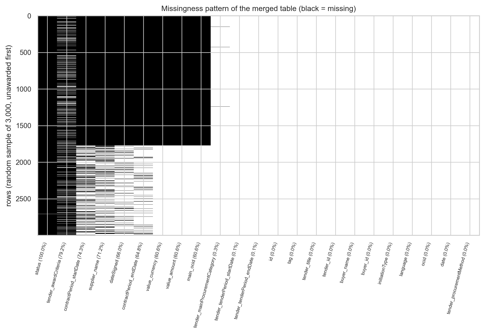
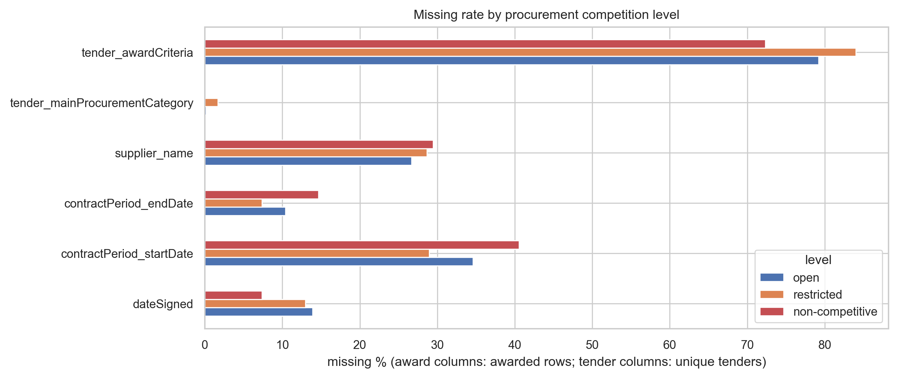
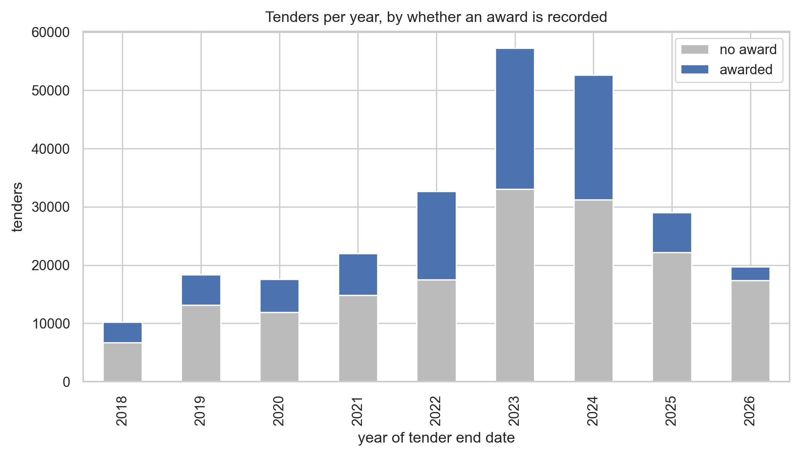
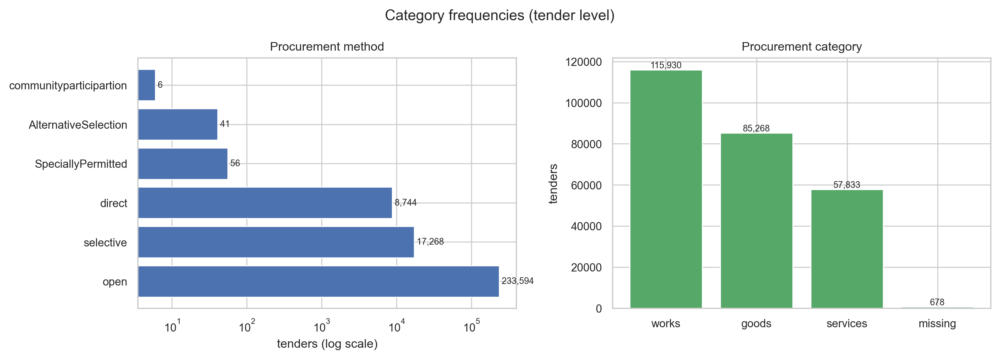
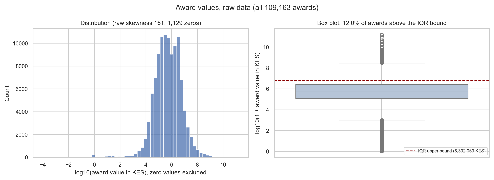
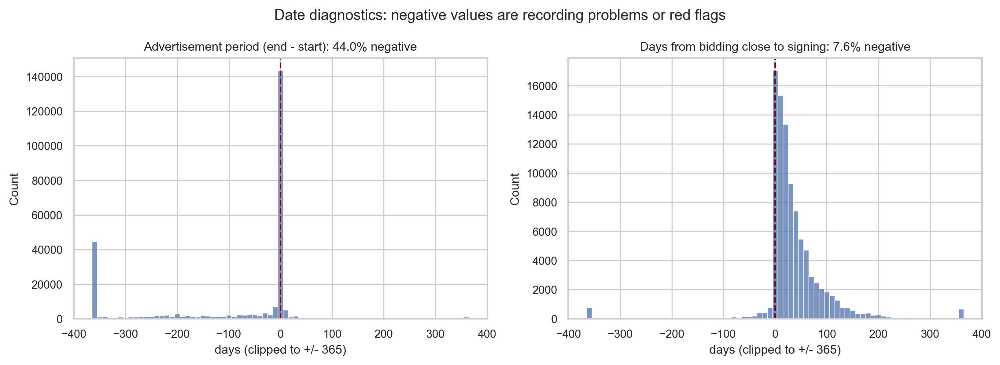

# An Explainable Risk-Triage System for Public Procurement Oversight in Kenya

An explainable AI system that ranks Kenyan government contracts by integrity risk and presents them to auditors as a prioritized review queue. Addresses UN SDG 16: Peace, Justice and Strong Institutions.

This README contains the complete Phase 1 work: the data audit and the full preprocessing strategy. `phase1_strategy/Phase1_Strategy_Report.pdf` contains the strategy in report form; this README adds the full data overview.

## Contents

1. [Problem Statement](#-problem-statement)
2. [Task Type and Target](#-task-type-and-target)
3. [Data Overview](#-data-overview)
4. [Preprocessing Strategy](#-preprocessing-strategy)
5. [Decision Log](#-decision-log)
6. [Strategy Tracking](#-strategy-tracking)
7. [Repository Structure](#-repository-structure)
8. [How to Reproduce](#-how-to-reproduce)
9. [References](#-references)

---

## 📌 Problem Statement

Kenya publishes over 260,000 public procurement records through the Public Procurement Regulatory Authority (PPRA), covering national government and all 47 counties. Oversight bodies review contracts by hand and can inspect only a fraction of them. The constraint is no longer access to records: it is the lack of a way to decide which records deserve attention first.

This project builds a risk-triage system that ranks contracts by integrity risk and returns them to an auditor as a prioritized review queue, with the reasons for each flag. The intended users are procurement analysts and investigators at oversight bodies such as the Ethics and Anti-Corruption Commission (EACC) and the PPRA, and civil-society procurement monitors.

The system estimates **review priority, not wrongdoing**. Red-flag indicators are proxies for risk and fire on legitimate contracts as well as irregular ones, so the output informs human judgement rather than constituting a finding.

---

## 🎯 Task Type and Target

**Unsupervised risk ranking.** No dataset labels a Kenyan contract as corrupt. Framing this as supervised classification or regression would require inventing labels, making any reported accuracy meaningless.

The target $`Y`$ is a composite risk score built from red-flag indicators, following the Corruption Risk Index (CRI) methodology [3, 4]. Each indicator $`f_k`$ lies in $`[0, 1]`$, and the score averages the indicators available for each contract:

```math
R(c) = \frac{\sum_{k \in A(c)} w_k \, f_k(c)}{\sum_{k \in A(c)} w_k}
```

where $`A(c)`$ is the set of indicators computable for contract $`c`$. Equal weights are the default.

Two components produce the ranking. A **rule-based composite index** $`R(c)`$ supplies transparent, literature-grounded signals and is the primary output. An **Isolation Forest** [7] complements it by detecting contracts that are unusual in the combination of their features, even where no single flag is extreme.

- **Sample size ($`N`$):** 277,325 merged rows; the 109,163 awarded contracts form the scoring unit
- **Feature count ($`P`$):** 23 raw columns in the merged working table
- **Target ($`Y`$):** $`R(c) \in [0, 1]`$, the average of the available red-flag indicators

---

## 📊 Data Overview

Everything in this section describes the **raw data, before any preprocessing**. The figures and numbers are reproduced by `phase1_strategy/data_overview.py`.

### Source

- **Publisher:** Kenya PPRA, via the Open Contracting Partnership Data Registry, publication 147 [1]: <https://data.open-contracting.org/en/publication/147>
- **Standard:** Open Contracting Data Standard (OCDS) 1.1 [2]
- **Format:** one archive, `kenya_ppra_full.csv.tar.gz` (about 55 MB), containing five linked CSV files
- **Coverage:** July 2018 to August 2026
- **Licence:** open government data under Executive Order No. 2 of 2018; no explicit licence is declared

### The Five Files

The release follows the life of a public purchase: a buyer announces a **tender**, picks a winner (the **award**), names the winning **supplier**, signs a **contract**, and every organization involved is listed as a **party**.

| File | Rows | Columns | One row is | What it tells us |
|---|---:|---:|---|---|
| `main.csv` | 259,709 | 15 | a tender | who is buying, what, how the supplier is chosen, and the bidding dates |
| `awards.csv` | 109,163 | 9 | an award | the value of each award and the planned contract period |
| `awards_suppliers.csv` | 79,870 | 5 | a named winner | which supplier won each award |
| `contracts.csv` | 109,163 | 12 | a signed contract | when the contract was signed and its status |
| `parties.csv` | 813,078 | 16 | an organization in a process | every buyer and supplier, with registration and contact details |

**How they link.** Every file links back to `main.csv` through `main_ocid`, which matches `ocid` in `main.csv`. Awards link to suppliers through `awards_suppliers.awards_id` and to contracts through `contracts.awardID`, both matching `awards.id`.

**What the row counts already show.** 259,709 tenders produced only 109,163 awards: 168,162 tenders (60.6%) have no recorded award. And 109,163 awards have only 79,870 named winners: 26.8% of awards do not record who won.

### Features in Each File

Missing percentages are measured on each file before merging.

#### `main.csv`: tenders (259,709 rows)

| Column | Type | Description | Missing % |
|---|---|---|---:|
| `id` | Nominal | Record ID of the compiled release | 0.00 |
| `tag` | Nominal | Release stage; always "compiled" | 0.00 |
| `date` | Datetime | When the record was published, not when the tender happened | 0.00 |
| `ocid` | Nominal | Open Contracting ID: one per procurement process; the main join key | 0.00 |
| `language` | Nominal | Always "en" | 0.00 |
| `initiationType` | Nominal | Always "tender" | 0.00 |
| `buyer_id` | Discrete | ID of the buying government entity (1,211 distinct buyers) | 0.00 |
| `buyer_name` | Nominal | Name of the buying entity | 0.00 |
| `tender_id` | Nominal | The buyer's own reference number | 0.00 |
| `tender_title` | Text | What is being purchased, in free text | 0.00 |
| `tender_mainProcurementCategory` | Nominal | Goods, works or services | 0.26 |
| `tender_procurementMethod` | Ordinal | How the supplier was chosen: open, selective, direct, and three rare methods | 0.00 |
| `tender_tenderPeriod_startDate` | Datetime | When bidding opened | 0.09 |
| `tender_tenderPeriod_endDate` | Datetime | The bidding deadline | 0.09 |
| `tender_awardCriteria` | Nominal | The rule used to pick the winner, such as lowest price | 79.30 |

#### `awards.csv`: awards (109,163 rows)

| Column | Type | Description | Missing % |
|---|---|---|---:|
| `id` | Nominal | Award ID; links to suppliers and contracts | 0.00 |
| `title` | Text | What was awarded | 0.00 |
| `description` | Text | Longer description of the award | 95.25 |
| `value_amount` | Continuous | Award value | 0.00 |
| `value_currency` | Nominal | Always "KES" (Kenyan Shilling) | 0.00 |
| `contractPeriod_startDate` | Datetime | Planned contract start | 34.60 |
| `contractPeriod_endDate` | Datetime | Planned contract end | 10.46 |
| `main_ocid` | Nominal | Link to the tender in `main.csv` | 0.00 |
| `main_id` | Nominal | Link to the release record in `main.csv` | 0.00 |

#### `awards_suppliers.csv`: winning suppliers (79,870 rows)

| Column | Type | Description | Missing % |
|---|---|---|---:|
| `id` | Nominal | Supplier record ID; not a stable firm ID (23.76% of names appear under more than one ID) | 0.00 |
| `name` | Text | Supplier name as written, with inconsistent spelling and case | 0.00 |
| `main_ocid` | Nominal | Link to the tender | 0.00 |
| `main_id` | Nominal | Link to the release record | 0.00 |
| `awards_id` | Nominal | Link to the award in `awards.csv` | 0.00 |

#### `contracts.csv`: signed contracts (109,163 rows)

| Column | Type | Description | Missing % |
|---|---|---|---:|
| `id` | Nominal | Contract reference, including the buyer's contract number | 0.00 |
| `title` | Text | What the contract is for | 0.00 |
| `description` | Text | Longer description | 95.25 |
| `dateSigned` | Datetime | When the contract was signed | 13.64 |
| `awardID` | Nominal | Link to the award in `awards.csv` | 0.00 |
| `value_amount` | Continuous | Contract value; matches the award value | 0.00 |
| `value_currency` | Nominal | Always "KES" | 0.00 |
| `period_startDate` | Datetime | Contract start | 3.12 |
| `period_endDate` | Datetime | Contract end | 10.46 |
| `main_ocid` | Nominal | Link to the tender | 0.00 |
| `main_id` | Nominal | Link to the release record | 0.00 |
| `status` | Nominal | Only ever filled as "terminated" (105 contracts) | 99.90 |

#### `parties.csv`: organizations (813,078 rows)

| Column | Type | Description | Missing % |
|---|---|---|---:|
| `id` | Nominal | Organization ID | 0.00 |
| `name` | Text | Organization name | 0.02 |
| `roles` | Nominal | "buyer" or "supplier" | 0.00 |
| `main_ocid` | Nominal | Link to the tender | 0.00 |
| `main_id` | Nominal | Link to the release record | 0.00 |
| `address_region`, `address_locality`, `address_countryName` | Nominal | Where the organization is based | 32.10 |
| `address_postalCode` | Nominal | Postal code | 85.15 |
| `address_streetAddress` | Text | Street address | 84.63 |
| `identifier_id` | Nominal | Registration number; present for 100% of suppliers | 32.10 |
| `identifier_scheme` | Nominal | Which registry issued the number | 32.10 |
| `identifier_legalName` | Text | Official registered name | 32.12 |
| `contactPoint_name` | Text | Contact person | 82.84 |
| `contactPoint_email` | Text | Contact email | 85.69 |
| `contactPoint_telephone` | Text | Contact phone number | 87.05 |

### The Merged Working Table

For analysis, `main`, `awards`, `awards_suppliers` and `contracts` are joined into one table of **277,325 rows by 23 columns**: one row per award, plus one row for each tender with no award. It is larger than `main.csv` because 91,547 tenders carry the 109,163 awards between them.

| Merged-table measure | Value |
|---|---|
| Missing cells | 27.73% |
| Rows complete across all 23 columns | 1 |
| Rows complete, excluding `status` and `tender_awardCriteria` | 38,538 (13.90%) |
| Tenders with no award | 168,162 (60.6%) |

Missingness of the award-stage columns at merged-table level, and among the 109,163 awarded rows:

| Column | Missing | % merged | % of awarded | Mechanism and evidence |
|---|---:|---:|---:|---|
| `status` | 277,220 | 99.96 | 99.90 | MNAR: only terminations are ever recorded |
| `tender_awardCriteria` | 219,751 | 79.24 | n/a | MNAR: selection criteria left undocumented |
| `contractPeriod_startDate` | 205,933 | 74.26 | 34.60 | Structural + MAR |
| `supplier_name` | 197,455 | 71.20 | 26.83 | Structural + MNAR: winner not recorded |
| `dateSigned` | 183,072 | 66.01 | 13.66 | Structural + MAR |
| `contractPeriod_endDate` | 179,576 | 64.75 | 10.46 | Structural + MAR |
| `value_amount`, `value_currency`, `main_ocid` | 168,162 | 60.64 | 0.00 | Structural: tender has no award |
| `tender_mainProcurementCategory` | 722 | 0.26 | n/a | MAR |
| tender-period start and end dates | 248 | 0.09 | n/a | Both missing together |
| remaining 12 columns | 0 | 0.00 | 0.00 | Complete |

"Structural" means the field does not exist because the tender never reached the award stage. The mechanisms are tested in the next section.

### Statistical Diagnostics

**Category frequencies (tender level).**

| Procurement method | Tenders | % |
|---|---:|---:|
| open | 233,594 | 89.94 |
| selective | 17,268 | 6.65 |
| direct | 8,744 | 3.37 |
| SpeciallyPermitted | 56 | 0.02 |
| AlternativeSelection | 41 | 0.02 |
| community participation | 6 | 0.00 |

Procurement category: works 115,930 (44.6%), goods 85,268 (32.8%), services 57,833 (22.3%), missing 678 (0.3%).

**Award values (all 109,163 awards).**

| Statistic | Value |
|---|---|
| Mean / median | 15,409,356 / 498,150 KES |
| Maximum | 160.6 billion KES |
| Quartiles Q1 / Q3 | 111,537 / 2,599,744 KES |
| Skewness | 161.0 (extremely right-skewed) |
| Skewness of log(1 + value) | −1.38, or −0.51 once the zeros are excluded |
| Zero-value awards | 1,129 (1.03%) |
| IQR upper bound (Q3 + 1.5 × IQR) | 6,332,053 KES; 12.0% of awards lie above it |
| 99th percentile | 135,000,000 KES |

**Dates.**

| Measure | Value |
|---|---|
| Advertisement period (bidding end − start) | 44.0% of tenders negative (42.2% counted per merged row, as in the Phase 1 report); median 0 days among the rest |
| Decision period (signing − bidding end) | n = 94,140; median 22 days; 7.6% signed before bidding closed; skewness −2.69 |

**Missingness mechanism tests.** A chi-square test of independence between each column's missingness and the procurement competition level (open / restricted / non-competitive). A small p-value rejects Missing Completely at Random (MCAR). Cramér's V measures how strong the link is; with this many rows it matters more than p.

| Column | Missing % | χ² | p | Cramér's V | Missing % open / restricted / non-competitive | MCAR |
|---|---:|---:|---:|---:|---|---|
| `dateSigned` | 13.66 | 137.5 | 1.4e-30 | 0.035 | 13.93 / 12.96 / 7.35 | rejected |
| `contractPeriod_startDate` | 34.60 | 118.1 | 2.3e-26 | 0.033 | 34.60 / 28.95 / 40.57 | rejected |
| `contractPeriod_endDate` | 10.46 | 114.5 | 1.4e-25 | 0.032 | 10.42 / 7.39 / 14.68 | rejected |
| `supplier_name` | 26.83 | 21.7 | 1.9e-05 | 0.014 | 26.66 / 28.65 / 29.44 | rejected |
| `tender_mainProcurementCategory` | 0.26 | 1420.3 | 3.8e-309 | 0.074 | 0.17 / 1.67 / 0.01 | rejected |
| `tender_awardCriteria` | 79.30 | 493.7 | 6.2e-108 | 0.044 | 79.21 / 84.01 / 72.35 | rejected |

Award columns are tested on awarded rows only, tender columns on unique tenders. Every column rejects MCAR, but every link is weak (V below 0.1): the gaps are not random, yet procurement method explains only a small part of them. Missing Not at Random (MNAR) cannot be tested from data alone.

**Suppliers.** 23.76% of normalized supplier names appear under more than one supplier ID, while no ID carries more than one name, so the ID marks a record, not a firm. In 79.3% of processes, `parties.csv` lists more suppliers than there are winners (median 3), suggesting losing bidders are recorded too.

### Figures

**Missingness pattern.** The black block at the top is the 60.6% of tenders with no award: their award columns do not exist, rather than being missing.



**Missing rate by competition level.** The visual version of the MAR tests: rates differ by level, but only slightly.



**Tenders per year.** How the records spread over time, and the share with a recorded award.



**Method and category frequencies.** Open tenders dominate; three methods have fewer than 60 tenders each.



**Award values.** On a log scale the values become readable; the box plot shows the IQR bound and the long upper tail.



**Date diagnostics.** Many advertisement periods are negative, which is a recording problem; contracts signed before bidding closed are a possible red flag.



---

## 🧹 Preprocessing Strategy

Every decision below is justified by a finding in the [Data Overview](#-data-overview).

### Scoring Unit

The 168,162 unawarded tenders have no value, supplier or contract to review. They are audited but not scored. The scoring unit is the **awarded contract** (109,163 rows), because that is the object an auditor reviews. This removes the structural share of every award-stage column's missingness.

### Missingness Treatment

**MNAR columns: binary flags, never imputed.** These are missing because of what the value would have been. An undocumented selection rule or an unnamed winner is itself a transparency failure, so imputing would erase the signal. Each becomes a flag:

- `award_criteria_missing` = 1 if `tender_awardCriteria` is blank, else 0
- `supplier_missing` = 1 if an award has no named supplier (26.83% of awards), else 0
- `is_terminated` = 1 if `status` equals "terminated", else 0

MNAR cannot be proven from data alone; this diagnosis rests on domain reasoning.

**MAR columns: imputed within procurement-method groups.** The chi-square tests reject MCAR.

- `dateSigned` (13.66% of awards; open 13.9%, restricted 13.0%, non-competitive 7.4%). Where it is missing, the decision-period indicator $`f_3`$ is dropped from $`A(c)`$ rather than imputed. For the Isolation Forest input `days_to_signing`, missing values are imputed with the **median within each procurement method**, recorded in a flag `signing_date_missing`. The median is used rather than the mean because the distribution is strongly skewed (−2.69).
- `tender_mainProcurementCategory` (722 rows, 0.26%) was expected to be MCAR, but it is missing ten times more often for restricted tenders (1.67%) than for open ones (0.17%). It is imputed with the **mode within each procurement method**. The gaps are spread over 256 buyers, with no buyer above 3.6%, so they are not one buyer's reporting habit.
- `contractPeriod_startDate` and `contractPeriod_endDate` are also MAR, but they feed no indicator, so they are kept for display and **excluded from model inputs**. Imputing a field the model never uses adds no information.

**Tender-period dates.** The 248 records missing both dates cannot be placed in time, so they are excluded at the split instead of imputed. KNN and multiple imputation were rejected for these small gaps: they add computational cost for negligible gain.

### Outlier Treatment

`value_amount` is heavily right-skewed (skewness 161.0), so the **IQR rule** is used for detection. The Z-score rule was rejected because it assumes a Gaussian distribution.

```math
\text{Lower} = Q_1 - 1.5 \times IQR, \qquad \text{Upper} = Q_3 + 1.5 \times IQR
```

With $`Q_1 = 111{,}537`$ and $`Q_3 = 2{,}599{,}744`$ KES, the upper bound is 6,332,053 KES and the lower bound is negative. 12.0% of awards exceed the upper bound. Capping there would truncate one award in eight, mostly legitimate large works contracts.

**Treatment: Winsorization at the 99th percentile**, not row deletion and not IQR capping. The threshold is learned on the training set only (135,000,000 KES on the full data). A row with an extreme value still carries valid signal in every other column, so deleting it loses information. Because extreme values matter in integrity analysis, a flag `above_p99` records that a value was capped, and the raw value stays visible to auditors.

**Zero-value awards** (1,129, 1.03%) are not plausible for a signed award. Each is flagged in `zero_value_award` and excluded from the value-based indicators $`f_4`$ and $`f_5`$; a zero has no first digit for Benford's law. For the Isolation Forest value input, zeros are imputed with the median within procurement category, with the flag retained.

### Entity Resolution

Supplier IDs are not stable firm IDs: 23.76% of normalized names appear under more than one ID. Resolution has three stages:

1. **Exact:** normalize names (case, whitespace, punctuation, legal suffixes such as Ltd/Limited) and merge exact matches. This alone collapses the multi-ID names.
2. **Fuzzy:** token sort ratio of at least 90 within blocks sharing a first token, to catch spelling variants.
3. **Confirm:** `identifier_id` in `parties.csv`, present for 100% of supplier parties, confirms or vetoes each candidate merge.

The error rate is estimated on 200 hand-labelled supplier-name pairs (precision and recall). High-risk suppliers are then checked against the [World Bank Debarred Firms list](https://www.worldbank.org/en/projects-operations/procurement/debarred-firms), the [Kenya Gazette](https://new.kenyalaw.org/gazettes/) company register, and the [OpenSanctions](https://www.opensanctions.org/datasets/default/) database of politically exposed persons.

### Feature Engineering

Five indicators enter $`R(c)`$, plus one candidate pending validation [4, 5, 6].

**$`f_1`$, direct award.** 1 if the procurement method is "direct" or "SpeciallyPermitted", else 0. These methods bypass competition; 8,800 tenders (3.4%) use them.

**$`f_2`$, award criteria missing.** 1 if `tender_awardCriteria` is blank, else 0.

**$`f_3`$, decision period.** The days between the bidding deadline and contract signing. A very short decision period suggests the evaluation was decided in advance [3]:

```math
d(c) = t_{\text{signed}}(c) - t_{\text{close}}(c), \qquad f_3(c) = 1 - \hat{F}_{\text{train}}\big(d(c)\big)
```

where $`\hat{F}_{\text{train}}`$ is the empirical distribution function of $`d`$ on the training set, so shorter periods score higher. Contracts signed before bidding closed (7.6%) receive the highest scores: they are either irregular or recording errors, and both warrant review. $`f_3`$ **replaces the advertisement period** originally planned, which is unusable: 44.0% of tenders have a start date after the end date, and the rest have a median of 0 days. Imputing it would manufacture a signal.

**$`f_4`$, supplier concentration.** The share of buyer $`b`$'s earlier awarded value that went to supplier $`s`$, over an expanding window of awards dated before contract $`c`$, after entity resolution and excluding zero values:

```math
f_4(c) = \frac{\sum_{c' \in C^{\lt t}_{b,s}} v(c')}{\sum_{c' \in C^{\lt t}_{b}} v(c')}
```

where $`C^{\lt t}_{b}`$ is buyer $`b`$'s awards before the date $`t`$ of contract $`c`$, and $`C^{\lt t}_{b,s}`$ the subset won by $`s`$. Values near 1 indicate dependence on one supplier.

**$`f_5`$, Benford deviation.** Conformity of buyer $`b`$'s earlier non-zero award values to Benford's law, measured by the mean absolute deviation (MAD) of first-digit proportions:

```math
\text{MAD}_b = \frac{1}{9}\sum_{d=1}^{9}\left|\hat{p}_{b,d} - E_d\right|, \qquad E_d = \log_{10}\!\left(1 + \tfrac{1}{d}\right)
```

and $`f_5(c) = \hat{F}_{\text{train}}(\text{MAD}_b)`$. MAD is chosen over chi-squared because chi-squared grows with sample size, so large buyers would score higher for the same proportional deviation. $`f_5`$ requires at least 100 earlier awards.

**$`f_6`$ (candidate), single supplier party.** The release has no tenderer count, so single bidding, the most validated CRI indicator [4], cannot be read directly. But 79.3% of processes list more supplier parties than winners, consistent with bidders being recorded as parties. $`f_6 = 1`$ if a process lists exactly one supplier party. It enters $`R(c)`$ only if a manual check of 50 processes against tender notices on the PPRA portal confirms that the extra parties are bidders.

**Indicator coverage map.** Which integrity indicators the release can and cannot support:

| Indicator | Source fields | Coverage (awarded contracts) | Status |
|---|---|---|---|
| $`f_1`$ direct award | procurement method | 100% | Used |
| $`f_2`$ criteria missing | award criteria | 100% | Used |
| $`f_3`$ decision period | `dateSigned`, tender end date | 86.2% | Used |
| $`f_4`$ supplier concentration | value, resolved supplier | all but a buyer's first award | Used |
| $`f_5`$ Benford MAD | value | buyers with at least 100 earlier awards | Used |
| $`f_6`$ single supplier party | `parties.csv` | 79.3% list extra parties | Pending validation |
| Advertisement period | tender start and end dates | 44.0% negative | Rejected |
| Single bidding (tenderer count) | `tender.tenderers` | absent from the release | Not computable |

### Encoding

- **Procurement method: ordinal, three levels.** open = 0 (233,594); restricted = 1 (selective 17,268, AlternativeSelection 41, community participation 6); non-competitive = 2 (direct 8,744, SpeciallyPermitted 56). The rare methods are too small for levels of their own, and there is no defensible order between direct and specially permitted awards. One-hot encoding was rejected because it would discard the ordering of competition levels.
- **Procurement category: one-hot.** Goods, works and services have no natural order, so ordinal encoding was rejected. One level is dropped to avoid perfect collinearity in the VIF screen and PCA.
- **Binary flags:** `award_criteria_missing`, `supplier_missing`, `is_terminated`, `zero_value_award`, `above_p99`, `signing_date_missing`.
- **Dropped:** `language`, `initiationType`, `tag` and `value_currency` (constant), identifier columns used only for joining, and the contract-period dates (used by no indicator).

### Scaling and Transformation

**`value_amount`: Winsorize, log, then standardize.**

```math
x_v(c) = \log\big(1 + \min(v(c),\, q^{\text{train}}_{0.99})\big)
```

The Isolation Forest chooses each split value uniformly between a feature's minimum and maximum. On the raw scale, with a median of 498,150 KES and a maximum of 160.6 billion KES, almost every split would fall in the empty upper range, so the log transform genuinely changes model behaviour. $`\log(1 + x)`$ is used rather than $`\log(x)`$ because $`\log(0)`$ is undefined. StandardScaler ($`\mu = 0`$, $`\sigma = 1`$) does not affect the Isolation Forest, which is invariant to per-feature scaling, but it is required for PCA and the VIF screen, where unequal variances would let one feature dominate. MinMaxScaler was rejected because it is sensitive to the remaining extreme values.

**`days_to_signing`: signed log, then standardize.** 7.6% of values are negative, so $`\log(1 + x)`$ cannot be applied. $`\text{sign}(d)\log(1 + |d|)`$ compresses both tails.

**Indicators $`f_1`$ to $`f_6`$** lie in $`[0, 1]`$ by construction, either binary or empirical-distribution scores, so they need no further scaling for $`R(c)`$. They are standardized only for PCA.

### Statistical Test Matrix

Because $`R(c)`$ is built from the indicators, correlating an indicator with $`R(c)`$ would be circular: the association is guaranteed by construction. Each indicator $`f_k`$ is therefore tested against the **leave-one-out score** $`R_{-k}(c)`$, which excludes $`f_k`$. Inputs that are not components are tested against $`R(c)`$. The procurement method and `days_to_signing` are tested against $`R_{-1}`$ and $`R_{-3}`$, since $`f_1`$ and $`f_3`$ are built from them.

| Feature | Type | Target | Chosen / Rejected / Reason |
|---|---|---|---|
| $`f_1`$ direct award | Binary | $`R_{-1}`$ | **Chosen:** point-biserial $`r`$. **Rejected:** chi-square, which needs a categorical target. |
| $`f_2`$ criteria missing | Binary | $`R_{-2}`$ | Same as $`f_1`$. |
| $`f_3`$ decision-period score | Continuous, [0, 1] | $`R_{-3}`$ | **Chosen:** Spearman $`\rho`$. **Rejected:** Pearson $`r`$; $`R`$ mixes binary and rank-based components, so it is not Gaussian, and $`d`$ has skewness −2.69. |
| $`f_4`$ supplier concentration | Continuous, [0, 1] | $`R_{-4}`$ | **Chosen:** Spearman $`\rho`$. **Rejected:** Pearson $`r`$; shares typically pile up at 0 and 1. |
| $`f_5`$ Benford deviation | Continuous, [0, 1] | $`R_{-5}`$ | Same as $`f_4`$. |
| $`f_6`$ single supplier party | Binary | $`R_{-6}`$ | Same as $`f_1`$, if validated. |
| `value_amount` (log) | Continuous | $`R`$ | **Chosen:** Spearman $`\rho`$. **Rejected:** Pearson $`r`$; skewness −0.51 excluding zeros, −1.38 with them. |
| `days_to_signing` | Continuous | $`R_{-3}`$ | **Chosen:** Spearman $`\rho`$. **Rejected:** Pearson $`r`$; skewness −2.69. |
| procurement method | Ordinal, 3 levels | $`R_{-1}`$ | **Chosen:** Spearman $`\rho`$. **Rejected:** Pearson $`r`$; codes 0 to 2 are ranks with unequal gaps. |
| procurement category | Nominal, 3 levels | $`R`$ | **Chosen:** Kruskal-Wallis $`H`$ with $`\varepsilon^2`$ effect size, plus mutual information. **Rejected:** ANOVA $`F`$, which assumes normal within-group distributions that a bounded, non-Gaussian $`R`$ violates; Pearson and Spearman, which need an ordering. |
| `supplier_missing`, `zero_value_award` | Binary | $`R`$ | **Chosen:** point-biserial $`r`$, as for $`f_1`$. |
| `is_terminated` | Binary, 0.10% positive | $`R`$ | **Chosen:** Mann-Whitney $`U`$ with rank-biserial effect size. **Rejected:** point-biserial $`r`$, which is unstable with only 105 positives. |

### Multicollinearity Protocol

- **Screen:** pairwise Spearman $`|\rho| \geq 0.85`$ on continuous inputs (Spearman because the inputs are skewed and bounded), with the Variance Inflation Factor (VIF) above 10 on standardized inputs as a secondary check.
- **Decision rule:** keep the feature with higher coverage; on a tie, keep the literature-validated indicator. Association with $`R(c)`$ is never used as the tie-break, because that would reintroduce circularity.
- **Pairs collinear by construction, resolved in advance:** $`f_3`$ is a monotone transform of `days_to_signing`, and $`f_1`$ is the top level of the method encoding. The Isolation Forest receives the richer variable of each pair (`days_to_signing` and the method level), while $`R(c)`$ uses the indicators.

### Split and Leakage Prevention

**Temporal split by tender end date.** A random split would let a model trained on 2025 contracts score 2024 contracts, which is look-ahead bias. Upload dates were rejected because they record publication, not the procurement: tenders closing in 2021 carry 2025 upload timestamps.

| Set | Tender end date | Awarded contracts | Share |
|---|---|---:|---:|
| Train | 2018 to 2023 | 72,585 | 66.6% |
| Test | 2024 to 2026 | 36,399 | 33.4% |
| Excluded | missing or outside the window | 179 | 0.16% |

This mirrors deployment: a model trained on history scores contracts as they arrive.

**Hyperparameter selection.** `TimeSeriesSplit` with 5 folds inside the training period, each validation fold strictly after its training fold. With no labels, the criterion is **rank stability**: the Spearman correlation between the score rankings of the same validation fold under different random seeds. The number of trees and the subsample size are chosen to maximize it. The contamination parameter is not tuned, because the output is a ranking, not a binary label.

**Buyer-history leakage.** Supplier concentration and Benford deviation depend on a buyer's history. Both use an **expanding window**: a contract's buyer-level features use only that buyer's awards dated before it, in training, test and deployment alike. GroupKFold was rejected: separating a buyer's history from its future is exactly what these features need, and the leakage risk here is temporal ordering, not shared identity.

**Transformer fit architecture.** Every learned step is fit on `X_train` only, inside `sklearn.pipeline.Pipeline` and `ColumnTransformer`:

1. **Fit on `X_train` only:** impute category (mode within method) and `days_to_signing` (median within method), with flags; Winsorize value at the training 99th percentile, then $`\log(1 + x)`$; signed log for `days_to_signing`; fit the ordinal encoder (3 levels), one-hot encoder (drop first) and StandardScaler; fit the empirical distribution functions for $`f_3`$ and $`f_5`$; fit the Isolation Forest.
2. **For every contract, in date order:** compute $`f_4`$ and $`f_5`$ from the buyer's awards dated before it.
3. **Transform `X_test` without refitting:** apply all fitted transformers, then score $`R(c)`$ and the Isolation Forest's `decision_function`.

$`R(c)`$ is computed only from the contract's own record and from history dated before it, so no future information enters any feature.

---

## 📋 Decision Log

The Phase 1 plan, to be compared against the implementation in Phase 2.

| Decision | Justification | Method |
|---|---|---|
| Unawarded tenders | 60.6% have no award stage | Audited, not scored |
| MNAR missingness | Missingness is itself a risk signal | Binary flag |
| `dateSigned` (MAR) | Rate varies by method (7.4% to 13.9%) | $`f_3`$ unavailable; median within method + flag |
| Category (MAR) | Restricted 1.67% vs open 0.17% | Mode within method |
| Contract-period dates | Feed no indicator | Excluded from model inputs |
| Missing tender dates | Cannot be placed in time | Excluded at split |
| Zero-value awards | 1,129 implausible values | Flag; excluded from $`f_4`$, $`f_5`$ |
| Extreme values | 12.0% exceed the IQR bound; skewness 161.0 | Winsorize at training P99 + flag |
| `value_amount` transform | Uniform splits on a raw scale fail | $`\log(1 + x)`$, then StandardScaler |
| `days_to_signing` transform | 7.6% negative, skewness −2.69 | Signed log, then StandardScaler |
| Advertisement period | 44.0% negative, median 0 days | Rejected; replaced by decision period |
| Benford measure | Chi-squared grows with sample size | MAD, at least 100 earlier awards |
| Procurement method | Ordered competition levels | Ordinal encoding 0 to 2 |
| Procurement category | No natural order | One-hot encoding |
| Constant columns | Zero variance | Drop |
| Feature-target tests | Indicators are components of $`R`$ | Leave-one-out score $`R_{-k}`$ |
| Train/test split | Prevent look-ahead bias | Tender end date, 66.6 / 33.4 |
| Hyperparameter search | No labels available | TimeSeriesSplit, rank stability |
| Buyer-history leakage | Features need buyer history | Expanding window |
| Transformer fit | Must not see test data | Fit on `X_train` only via Pipeline |

---

## 🧭 Strategy Tracking

How each finding in the raw data shaped the strategy.

| Finding in the raw data | Strategy decision | Where |
|---|---|---|
| 60.6% of tenders have no award | Score awarded contracts only | [Scoring Unit](#scoring-unit) |
| `date` records publication, not the tender | Split by tender end date | [Split](#split-and-leakage-prevention) |
| `tender_awardCriteria` 79.3% missing, MCAR rejected | Binary flag, never imputed | [Missingness](#missingness-treatment) |
| 26.8% of awards name no winner | Flag `supplier_missing` | [Missingness](#missingness-treatment) |
| `status` only ever says "terminated" | Flag `is_terminated` | [Missingness](#missingness-treatment) |
| `dateSigned` missingness depends on method (V = 0.035) | Median within procurement method | [Missingness](#missingness-treatment) |
| Category missing ten times more for restricted tenders | Mode within procurement method | [Missingness](#missingness-treatment) |
| Contract dates MAR but used by no indicator | Excluded from model inputs | [Missingness](#missingness-treatment) |
| Award skewness 161.0; IQR bound flags 12.0% | IQR for detection; cap at P99 | [Outliers](#outlier-treatment) |
| 1,129 zero-value awards | Flag; excluded from value indicators | [Outliers](#outlier-treatment) |
| Supplier IDs are not stable firm IDs | Three-stage entity resolution | [Entity Resolution](#entity-resolution) |
| Advertisement period 44.0% negative | Rejected; replaced by decision period | [Feature Engineering](#feature-engineering) |
| Decision period valid for 94,140 awards | Indicator $`f_3`$ | [Feature Engineering](#feature-engineering) |
| `parties.csv` lists extra suppliers in 79.3% of processes | Candidate indicator $`f_6`$ | [Feature Engineering](#feature-engineering) |
| Three methods have under 60 tenders each | Three competition levels | [Encoding](#encoding) |
| Log of value still skewed (−1.38) | Spearman instead of Pearson | [Statistical Test Matrix](#statistical-test-matrix) |

---

## 📁 Repository Structure

```text
kenya-procurement-triage/
├── .gitignore                      # Excludes raw data, binaries, and local environments
├── requirements.txt                # Pinned package dependencies
├── README.md                       # Full Phase 1 data overview and strategy
├── data/
│   ├── raw/                        # Original unaltered dataset (excluded from git)
│   └── processed/                  # Cleaned, encoded, and scaled final dataset
├── phase1_strategy/
│   ├── Phase1_Strategy_Report.pdf  # Formatted version of this README's Phase 1 content
│   └── data_overview.py            # Reproduces the data overview figures and numbers
├── phase2_implementation/
│   ├── Phase2_Final_Report.pdf     # Decision log and strategy vs. reality audit (Phase 2)
│   └── notebooks/
│       └── pipeline_execution.ipynb # Executable notebook with diagnostics (Phase 2)
├── src/
│   ├── __init__.py                 # Package marker
│   ├── transformers.py             # Custom Scikit-Learn feature transformers
│   └── pipeline_builder.py         # Modular ColumnTransformer pipeline definitions
└── figures/                        # Publication-quality plots (300 DPI)
```

---

## 🚀 How to Reproduce

Tested with Python 3.13.

### 1. Clone the Repository and Set Up the Environment

```bash
git clone https://github.com/Razan-O-Elobeid/kenya-procurement-triage.git
cd kenya-procurement-triage

# Create and activate a virtual environment (optional but recommended)
python3 -m venv venv
source venv/bin/activate  # On Windows: venv\Scripts\activate

# Install dependencies
pip install -r requirements.txt
```

### 2. Prepare the Data

1. Download `kenya_ppra_full.csv.tar.gz` (approximately 55 MB) from the [Open Contracting Data Registry](https://data.open-contracting.org/en/publication/147).
2. Place the file in the `data/raw/` folder. Raw data is excluded from version control.

### 3. Reproduce the Data Overview

```bash
python phase1_strategy/data_overview.py
```

This prints the file sizes, missingness and statistics above, and saves the six figures to `figures/`.

---

## 📚 References

1. Open Contracting Partnership, "Kenya: Public Procurement Regulatory Authority (PPRA)," OCP Data Registry, publication 147, 2018. [Online]. Available: https://data.open-contracting.org/en/publication/147
2. Open Contracting Partnership, "Open Contracting Data Standard version 1.1," 2018. [Online]. Available: https://standard.open-contracting.org
3. M. Fazekas, I. J. Tóth, and L. P. King, "An objective corruption risk index using public procurement data," *European Journal on Criminal Policy and Research*, vol. 22, no. 3, pp. 369–397, 2016.
4. M. Fazekas and G. Kocsis, "Uncovering high-level corruption: Cross-national objective corruption risk indicators using public procurement data," *British Journal of Political Science*, vol. 50, no. 1, pp. 155–164, 2020.
5. World Bank Integrity Vice Presidency, *Most Common Red Flags of Fraud and Corruption in Procurement*. Washington, DC, USA: World Bank, 2009.
6. Open Contracting Partnership, "Red flags in public procurement: A guide to using data to detect and mitigate risks," OCP Guidance Document. [Online]. Available: https://www.open-contracting.org/resources/red-flags-in-public-procurement-a-guide-to-using-data-to-detect-and-mitigate-risks/
7. F. T. Liu, K. M. Ting, and Z.-H. Zhou, "Isolation forest," in *Proc. 8th IEEE Int. Conf. Data Mining (ICDM)*, Pisa, Italy, 2008, pp. 413–422.


---

## Phase 2: Implementation and Validation

Phase 2 implements the Phase 1 design on the real data and tests each design decision against measured evidence. Where the evidence contradicted a Phase 1 decision, the decision was changed and the change is recorded below with the numbers behind it.

### Quick start

```bash
conda activate triage            # Python 3.13, see requirements.txt
python tests/test_resolver.py    # 23 checks: supplier entity resolution, leakage, f4
python tests/test_pipeline.py    # 15 checks: transformers, full pipeline, leakage
python tests/test_tuning.py      # 12 checks: anomaly injection, selection rule
```

Then run `phase2_implementation/notebooks/pipeline_execution.ipynb` top to bottom. Raw data goes in `data/raw/full/` (extracted OCDS CSV files, not tracked).

### Repository layout

| Path | Contents |
|---|---|
| `src/data.py` | Loading, merging, date parsing, temporal split |
| `src/features.py` | `IndicatorBuilder`: indicators f1, f3, f4, f5, flags and R(c), expanding-window histories |
| `src/entity_resolution.py` | Supplier name matching, labelling samples, evaluation, `SupplierResolver` |
| `src/transformers.py` | `ClipGroupImputer`, `GroupModeImputer`, signed log |
| `src/pipeline.py` | Full pipeline: indicators, `ColumnTransformer`, Isolation Forest |
| `src/tuning.py` | Rank-stability tuning and synthetic anomaly injection |
| `src/diagnostics.py` | Little's MCAR test, Cramér's V |
| `tests/` | 50 synthetic checks (all pass) |
| `data/labels/` | Hand-labeled validation samples (entity pairs, single-bidder check) |
| `figures/` | The eight diagnostic figures (300 DPI) |
| `results/` | Tuning grid and ranked test-period scores |

### Pipeline

```
raw contracts (23 columns)
  -> IndicatorBuilder        f1, f3, f4, f5, flags, R(c); supplier identities resolved
  -> ColumnTransformer       value:  zeros as missing -> clip P1/P99 -> impute by category -> log(1 + x) -> scale
                             days:   clip P1/P99 -> impute by method -> signed log -> scale
                             method level, category (one-hot), f4, f5 (+ missing indicators), 5 flags
  -> IsolationForest         400 trees, max_samples 256, contamination not tuned
```

Every parameter (thresholds, medians, scalers, encoders, supplier identities) is fitted on the training period only. Training covers 2018 to 2023 (72,585 awarded contracts) and the held-out test period covers 2024 to 2026 (36,399). Pipeline check: 72,585 x 23 becomes 72,585 x 14 model inputs, and 36,399 x 23 becomes 36,399 x 14, with no rows lost and no missing values.

### Decision log: Phase 1 plan against Phase 2 evidence

| Step | Phase 1 plan | Phase 2 evidence | Decision |
|---|---|---|---|
| Missingness | Missingness driven by procurement method | Little's MCAR rejected (chi-square 2,526.8, df 16); Cramér's V with method 0.02 to 0.07, with recording year 0.10 to 0.90 | Missingness treated as driven by recording period (Fig 1.1) |
| f2, award criteria | Missing award criteria as a red flag | Field discontinued around 2021 (Cramér's V with year 0.903) | f2 removed from R(c) and the model |
| f5, Benford | At least 100 earlier awards per buyer | Coverage 62.6% | Buyer-group fallback with minimum 10; coverage 92.9% |
| Supplier identifier | Use `identifier_id` to confirm merges | One identifier per bid record (552,087 rows, 552,087 IDs) | Identifier step dropped |
| Entity resolution | Token sort ratio of 90 or more, first-token blocking | Threshold 90: precision 0.54 (184-pair development set); acronym rule precision 0.35 | Stronger name cleaning, then identical cores or core score of 95 or more; blocking and acronym rule dropped |
| Entity resolution, held-out test | 200 hand-labeled pairs | Held-out test sample (59 pairs): precision 0.98, recall 0.90, against 0.70 and 0.25 for a strict threshold on the same pairs | Adopted; 21,963 training names become 19,247 identities |
| f6, single bidding | Pending validation | 15 of 50 sampled processes verifiable on the public portal; 15 of 15 agree (95% CI 78% to 100%); below the pre-specified minimum of 30 | f6 kept out of R(c), pending validation |
| Contract value | Winsorize at P99, then log | Upper cap alone does not reduce skew after the log; 663 awards under 100 KES | Zeros as missing, clip at P1 (212 KES) and P99 (164.9M KES), then log; skew 137.5 to -0.23 (Fig 2.1, Fig 4.1) |
| Days to signing | Signed log | Range -3,911 to 1,499 days; early signings concentrated in 2022 to 2023 | Clip at P1/P99 (-310, 321 days) to bound the range, then signed log; all early signings kept |
| Flags | `above_p99` keeps the large-value signal | Clipping at P1 would erase the small-value signal; early signing needs an explicit flag | Added `below_p1` (0 < value < P1) and `is_signed_pre_closure` |
| Collinearity | Spearman of 0.85 or more, VIF over 10 | Days and f3: rho -1.00; method and f1: rho 0.74 | f1 and f3 excluded from the model; maximum VIF falls from 15.74 to 2.49 (Fig 3.1, Fig 3.2) |
| Feature-target tests | Leave-one-out targets | All associations small except supplier missing (r 0.29) | No feature dropped for weak association with R(c) (Fig 3.3) |
| R(c) | Mean of available indicators, no rescaling | Mean R 0.31 with three indicators against 0.26 with four; f4 averages 0.005 while f3 and f5 average 0.5 | Definition kept for comparability; coverage effect reported as a limitation |
| PCA | Diagnostic only | 11 of 14 components for 90% of variance, 12 for 95% | Original features kept (Fig 5.1) |
| Model tuning | Rank stability across five time-ordered folds | Stability 0.961 to 0.993; anomaly injection added | 400 trees, max_samples 256 (stability 0.9916) |

### Validation results

**Anomaly injection.** Synthetic anomalies were injected into each validation fold after fitting and scored against a top-5% threshold fixed on the clean validation scores (chance level 0.05). The selected model detects contracts signed 200 days before tender close with recall 0.842, but 50-fold value inflation with recall only 0.117 (mean 0.480). A plausible explanation is that inflated values usually stay within the normal range of the whole dataset, and the model has no buyer- or category-relative value feature. Sample size trades off the two: 256 is better for the date anomaly, larger samples somewhat better for value inflation.

**Test period.** With the threshold fixed on training scores, 3.1% of test contracts (1,131) are flagged, against 5.0% in training, indicating temporal drift. Model scores agree weakly with R(c) (Spearman 0.145 in training, 0.219 in test); neither is ground truth.

### Limitations

- No ground-truth corruption labels exist, so neither R(c) nor the anomaly score can be validated as a measure of corruption.
- R(c) depends on which indicators are available for a contract.
- The model is much less sensitive to inflated contract values than to early signing.
- Entity resolution was validated on pairs, by a single labeler, on small samples; complete company renamings cannot be detected from names.
- f6 could be verified for only 30% of sampled processes.
- Synthetic anomalies show sensitivity to specific distortions, not to real corruption.

### Planned next steps

- Sensitivity analysis: rescale f4 to a percentile score and test whether R(c) still depends on indicator availability.
- Sensitivity analysis: clipping alone against clipping plus signed log for days to signing.
- A buyer- or category-relative value feature.
- Bulk validation of single bidding with the procurement regulator's records.
- Explanations for flagged contracts (SHAP), an itemized red-flag scorecard, and an audit trail.
- Alternative detectors (Extended Isolation Forest) and checks against external watchlists.
